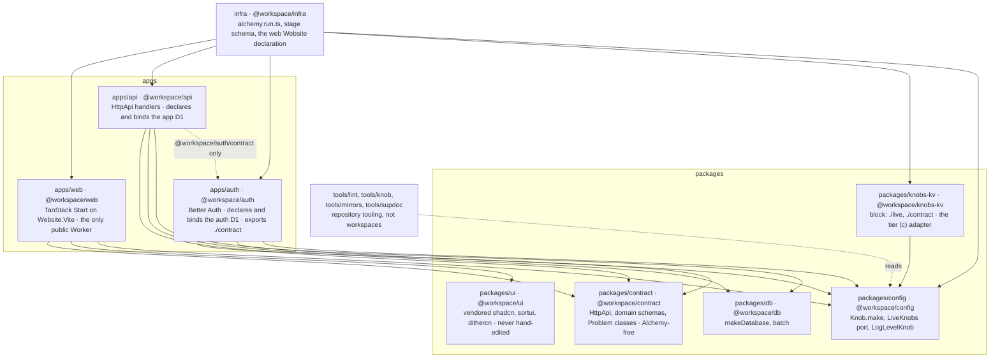
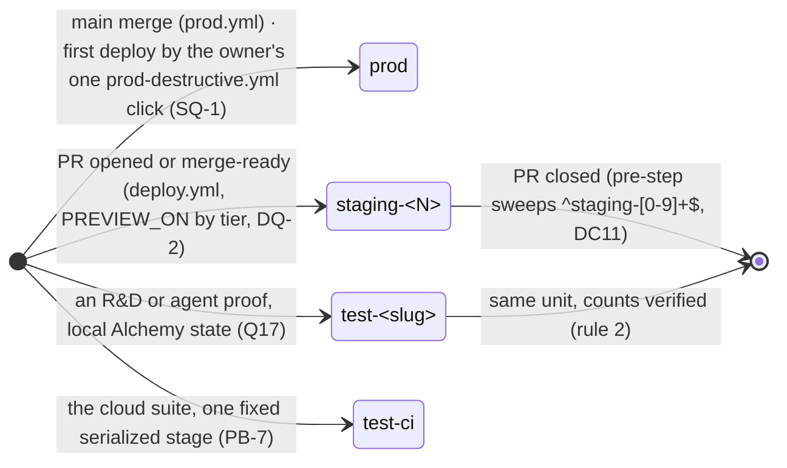
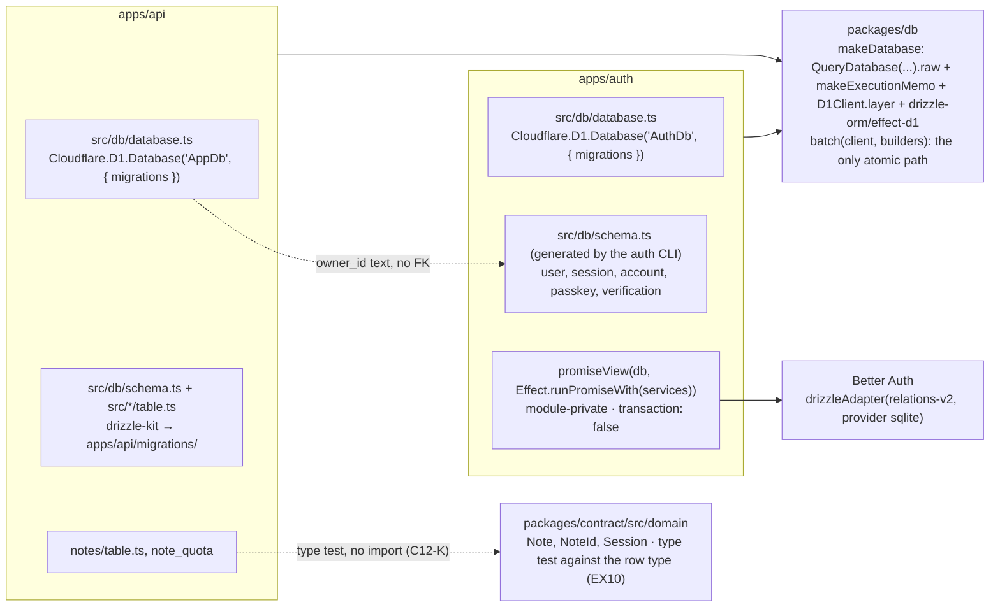
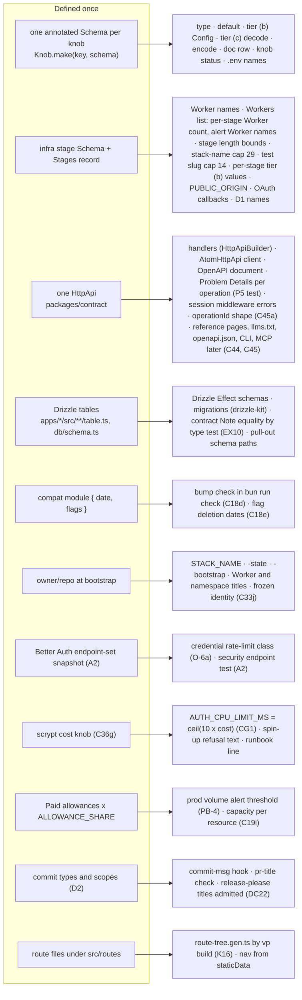
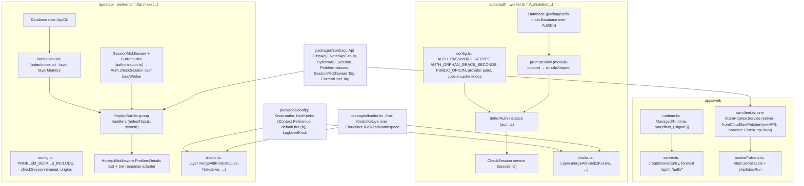
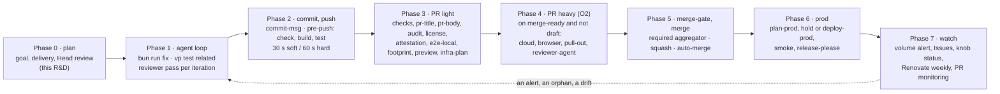

# Architecture plan: cf-template

Written 2026-11-10 against `main` `013dea6`. The frozen `cloudflare-monorepo-template` was read for direction only;
no code or pattern of it is a model here.

This document settles design; it files no issue and changes no convention. Every convention it builds on is
listed under `## Conventions` with its state against the conventions record. A convention this document would
need and the record does not have is written as a numbered settlement with a proposal row (`PENDING` until
ruled; the nine proposals stand as written) in `## Settlements`, never as a silent decision.
Numbered settlements ST1-ST14 (the eight routed
conflicts and the six unowned decisions) and the client bundle budget proposal live in `## Settlements`; the
deploy, settings, spin-up, Paid, external-dependency and auth design as ruled, and the producer facts the first
issues must prove, live in `## Platform operations`; the open items and what each blocks live in
`## Open items`.

Reading conventions: `Cn` is a convention row of the conventions record, `Cn<letter>` a part; `Rn`/`Kn`/`DCn`/`RSn`/
`SUn`/`LKn`/`CEn`/`SCn`/`EXn`/`ATn`/`BKn`/`UKn`/`CGn`/`CSn`/`PBn`/`En`/`Mn`/`On` are merit corrections from the
plan review; `OQ`/`FQ`/`DQ`/`SQ`/`LQ`/`LR`/`PB` are rulings by the maintainer or the maintainer's delegate. A fact
marked **inferred** was not proved by a unit; the first issue that depends on it proves it.

## Scope

**Day one** (brief section 3, binding): a Cloudflare project template that a person spins up with three logins
per machine once, then one command and one click per project ("one step" as a headline was retracted as a
`false_gate`, SU2), and that every later agent builds inside without being briefed on infrastructure. "Use this
template", `bun run bootstrap`, one `prod-destructive.yml` click per project (SQ-1 (a), SQ-2 (a)),
and a deployed, signed-in app exists. In scope on day one:

| Piece         | Day-one form                                                                                                                                                                                                                                                        | Owner row     |
| ------------- | ------------------------------------------------------------------------------------------------------------------------------------------------------------------------------------------------------------------------------------------------------------------- | ------------- |
| Topology      | three Workers `web`, `api`, `auth` over service bindings; `web` the only public door, forwarding `/api/*` and `/auth/*`; `api` and `auth` without a public address                                                                                                  | C7, C34       |
| Auth          | Better Auth self-hosted in `auth`; GitHub, Google, passkeys, email + password; OAuth providers opt-in by credentials; email + password with no email provider, so no self-service reset (FQ-2 (a), flagged)                                                         | C13, C35, C36 |
| Data          | Drizzle 1.0 RC on D1 through `drizzle-orm/effect-d1`, one client; app and auth each own a database; previews get their own empty databases (migrations applied, no seeds, C12-I), never a copy of `prod` data                                                       | C12, C13      |
| Frontend      | TanStack Start on `Cloudflare.Website.Vite`; shadcn `base`, free sortui and dithercn vendored in `packages/ui` on Tailwind v4; dark mode on                                                                                                                         | C9, C10       |
| Screens       | sign in and sign up; app shell with nav, user menu, sign out; account settings (profile, passkeys, connected accounts); the notes example feature end to end, removable; error and 404 pages                                                                        | C43, C11      |
| Observability | Cloudflare-native only: Workers Logs, Traces, Issues, Custom Alerts, `Cloudflare.Telemetry()`; Effect spans across the three Workers                                                                                                                                | C14           |
| Deploys       | Alchemy's official Action; `main` to `prod`, PR to `staging-<N>`, destroyed on close; checks first, quiet skip until credentials exist, no deploys from forks                                                                                                       | C15, C19      |
| Gates         | `bun run check` the one gate command; tracked hooks `pre-push` (`check`, `build`, `test`), `commit-msg`, `post-merge`; the cloud suite outside default discovery                                                                                                    | C20, C21, C38 |
| Agent surface | `AGENTS.md`, the six skills that exist on day one (five shared plus the vendored `supdoc` skill); the four project skills (`add-feature`, `add-block`, `write-migration`, `work-with-stacks`) land one per issue (AT1, C23e); source mirrors; supdoc inside `check` | C22, C23, C26 |
| Settings      | repository settings as a stateless program the maintainer runs locally, tier detected                                                                                                                                                                               | C25, C24      |

Docs site: Later (C44, deferred); learnings in `docs/decisions/docs-site.md`, committed by I-00. The
Later feature-request issue on this repository names a docs site on a standard framework (Astro or Nimbus)
whose Markdown and MDX supdoc verifies inside the site's normal build: a supdoc check fails that build on
a stale link or code block, the framework still renders the site, and supdoc builds no site itself; Nimbus stays prior
art with its findings; the supdoc day-one docs above stay.

Later add-ins, out of day one: R2, Queues and Workflows, Durable Objects, AI, email (a block under C32i, ST9), a
landing site, the contract-derived CLI and MCP surfaces (a Later feature-request issue gated on the generator FRs,
C45), generators for add-ins, the budget guard block (LR-4), KV Instant (a want), XState (a want), a second CI identity (M2, DQ-1's trigger). Out of this plan entirely: Cloudflare official skills,
renaming sibling repos, the global `work/` rule, the contract-strategy revisit, Grizzle (brief section 7).

"Removable" names two contracts in this plan: a **block** passes the pull-out test with C32i A1-A3 (the knobs
adapter, the email add-in); an **app slice** follows FQ-3's two-PR removal (the notes example). FQ-2's "behind a
one-line switch" is the first contract (ST9), not a third.

**Hard prerequisites of a generated project** (binding):

1. A Cloudflare account on **Workers Paid**. The approved hash cost (OWASP scrypt `N=2^15, r=8, p=3`, about 115 ms,
   OQ-1 (b)) exceeds the Free plan's 10 ms CPU limit; email + password fails on Free. Spin-up refuses a
   Free account up front with a message naming the limit and the cost (SU4). The plan is not
   readable through the `default` OAuth profile's scopes (digest X15; PB-3); that does not follow for the `admin`
   profile, an API token with both API-Tokens-Write permissions that can mint a token with any permission, so
   `I-bootstrap` tries first a minted Billing:Read token calling `GET /accounts/{account_id}/subscriptions` and
   reading the Workers rate plan (**unverified**: whether the Paid plan appears there and under which `rate_plan`
   id; not written into the runbook as fact before `I-bootstrap` observes it) and, failing that, the refusal is
   **a declared knob plus a documented check**: `CLOUDFLARE_PLAN` (enum, default `paid`)
   is declared at bootstrap; the bootstrap prints the account's plan page URL and the two facts to compare (10 ms
   CPU limit, 115 ms hash), and refuses when the knob says `free`. The knob also feeds the capacity formula; it
   never changes a design decision (PB-3). Everything stays inside the Paid included allowances: no element adds
   a meter by default; Secrets Store is the one accepted unknown meter.
2. A GitHub account on any plan, the tier **detected, never hard-coded**. Generated projects are private by default;
   the settings program applies what the tier allows and never fails spin-up over branch protection
   (C25e). The `prod`-destructive gate is the owner-only `workflow_dispatch` confirmation on every tier
   (the GitHub Pro protection probe: environment required reviewers 422 on private Pro); Actions on private repositories draw on
   the included credit (a flagged meter); private-repository CI is Linux-only.
3. The trust statement, with DQ-1 open: one GitHub identity, one Cloudflare account and one token, copied into the
   `prod` environment where environments exist (a same-value copy of the repository secret, N-4: the environment
   gives the `main`-only deployment-branch rule and a record of which jobs may name `prod`, and becomes a
   credential boundary only when two tokens are minted, O2 (b), DQ-1 (c)), so the preview token is
   `prod`-equivalent and every actor, label, fingerprint and reviewer check is satisfiable by the owner identity the
   agents hold. Day one buys a record and review attestation (DC1; default (a)); the runbook's "what you are agreeing
   to" block states it (C33), and states plainly, as its fifth sentence, that there is no self-service account
   recovery (no password reset, no email verification) until the email add-in is on (FQ-2 (a)), with the passkey
   nudge at sign-up as the mitigation and the one-line email switch (ST9) as the exit.
4. Bun at the `packageManager` pin, `gh`, Node `>= 22.12` wherever `bun run check` runs (Better Auth's generator
   under Bun mis-generates, RA-2).

**What this plan is not.** It settles design, not implementation order: the issue DAG slices it
vertically with one end-to-end path early (digest V1, V2). It builds on the frozen predecessor's direction, never
its code. Every custom piece below names its ladder rung (Cloudflare, Alchemy, Effect, own code, external) with a
citation or a steelmanned reason (the ladder rules); the ladder walks are in the
research sections and are restated here only where this plan adds or changes an element. Deferred item C1 of the
maintainer brief ("one contract, many surfaces", the contract research): every contract-derived surface is Later, the API
reference pages with the docs site (C44, deferred) and the CLI and MCP (C45), each a Later feature-request
issue; nothing derives a docs surface on day one, the supdoc day-one docs stay, and day one does not block them (the
`operationId` shape they key on is asserted from day one, C45a).

## Package graph

One Bun workspace, scope `@workspace/*`, Alchemy's single-stack shape (C1). A package exists when two
workspaces import it (K1); a block package is exempt when the pull-out matrix enumerates it (LR-1 (a)).
Explicit `exports` maps, no `.` entry, no barrels (C4); `packages/ui` alone exports per-directory wildcards (C10k,
LR-2 (a)). Repeated exact pins with the singleton-version test (C3).



Day-one package set and the one line each may not cross (W1 of `vercel-monorepo-template`, the workspace research
corrected, and this plan's lines for the packages the C1 list did not name, settlement ST6):

| Package             | Owns                                                                                                                                               | Must not own                                                                                                                                                            |
| ------------------- | -------------------------------------------------------------------------------------------------------------------------------------------------- | ----------------------------------------------------------------------------------------------------------------------------------------------------------------------- |
| `apps/web`          | routes, UI, the front door, the forward of `/api/*` and `/auth/*`, `runtime.ts`                                                                    | data access, D1, sign-in, session storage, runtime imports of `api` or `auth` (only `fetch` on the `AUTH` binding, C34g)                                                |
| `apps/api`          | product logic, the app D1 (declaration, schema, migrations), the HttpApi implementation, the session middleware implementation, `GET /api/session` | credentials, session issuing, public routing, UI, imports of `web`, imports of `auth` beyond `/contract`                                                                |
| `apps/auth`         | the Better Auth instance, the auth D1, `checkSession`, its Tag and Shape in `contract.ts`                                                          | app data, product routes, UI, any public address except through `web`                                                                                                   |
| `packages/contract` | HttpApi definitions, domain schemas, Problem classes, `Session`                                                                                    | Tags, implementations, runtime services, `Config` reads, UI, any workspace or `@alchemy.run/*` import                                                                   |
| `packages/db`       | `makeDatabase` (one `drizzle-orm/effect-d1` client per execution) and `batch`, the only atomic-write path                                          | schemas, migrations, any table, the Better Auth promise view (that is `apps/auth`'s, D1)                                                                                |
| `packages/config`   | `Knob.make`, the `LiveKnobs` port (an Effect `Context.Reference` defaulting to tier (b)), `LogLevelKnob`, the `Stages` schema's knob validators    | any knob value, the registry of live knobs (that is the knob command's, EX8), any KV import; no runtime Alchemy import (a type-only import of Alchemy types is allowed) |
| `packages/ui`       | everything the registries write, the one `components.json`, `globals.css`, its own tsconfig and typecheck                                          | first-party components (those are `apps/<app>/src/components`), any edit by hand (C10c, LR-3 (b))                                                                       |
| `packages/knobs-kv` | the KV adapter: `./live` declares the namespace, binds it and provides the `LiveKnobs` port; `./contract` the adapter's own schema                 | the port's type (that is `packages/config`), any knob definition, any write path (writes are the knob command's, C37k)                                                  |
| `infra`             | the Stack, the stage schema and `Stages` record, Worker composition, secret wiring, the state store, `web`'s `Website` declaration (ST13)          | request code, schemas, product logic                                                                                                                                    |
| `tools/*`           | repository rules (`tools/lint`), the knob command (`tools/knob`), mirrors (`tools/mirrors`), the interim supdoc installer (`tools/supdoc`)         | runtime code any Worker imports                                                                                                                                         |

Dependency direction is enforced by five `no-restricted-imports` overrides (K13, C6i): R1 an app imports
another app only as `@workspace/<app>/contract` and never `@workspace/infra`; R3 `packages/contract/src/domain/**`
imports no `effect/http`, `@alchemy.run/*` or `../api/*` and may import `effect/http-api`; R5 `apps/web/src/**` except the server entry imports no
`@workspace/{api,auth}/contract` and no `cloudflare:workers`; R7 services in `apps/{api,auth}/src` import no
`HttpApiBuilder` or `**/http`; R8 handlers (`**/http.ts`) import no `**/db/*`. Escapes outside a package's
`rootDir` fail natively with TS6059 under `tsc` 7.0.2 and `vp check` (PROVED by the apply-order probe), so no custom rule
guards the package boundary. Worker Tags live in each Worker's `src/contract.ts` (K2), and `packages/contract` stays
Alchemy-free, so `web` never imports a Tag: its bindings arrive on `env`. `infra` imports `@workspace/config`: the
Stack validates the `Stages` record with each knob's codec (ST4) and reads the per-Worker `limits` knobs (C40c)
through `Knob.make`, the one name for the knob module (it lives in `packages/config`; there is no separate
`knob()` module). No `apps/docs` package exists on day one: the docs site is Later (C44, deferred) and has
no node or edge in this graph.

## Request path

`web` is the only application Worker with an address. One more Worker has one: the state store `<stack>-state`,
reached over HTTPS by every deploy and by the maintainer's profile and guarded by its bearer token in Secrets Store
(N-6; `## Platform operations`, Workers Paid model and brakes). `web`'s custom TanStack server entry (`apps/web/src/server.ts`,
`createServerEntry`) dispatches `/api/*` and `/auth/*` to the service bindings before `handler.fetch`; the same
prefix constant feeds `assets.runWorkerFirst` (C9h) so static assets never shadow them. `api` and `auth` run with
`workersDev: false`, no domain, no routes (C34a; proved on `test-r-auth-surface`: the would-be host answers
Cloudflare 1042).

```mermaid
sequenceDiagram
  autonumber
  participant B as Browser
  participant W as web (public)
  participant A as api (binding API)
  participant U as auth (binding AUTH)
  participant D1a as app D1
  participant D1u as auth D1

  B->>W: GET /notes (Cookie: session_token, session_data)
  W->>W: strip traceparent, tracestate, b3 (C7f strip only)
  W->>A: GET /api/session via fromCloudflareFetcher(env.API) (SSR loader)
  A->>U: checkSession({ cookie }) over bindWorker RPC, Config timeout 500 ms (C7b, C7j)
  U->>U: getSession({ disableRefresh: true }) from the signed cookie cache; disableCookieCache when fresh (C34c, O4)
  U-->>A: Session | null
  A-->>W: 200 Session · 401 SessionRequired · 503 AuthUnavailable + Retry-After
  W-->>B: HTML (router tri-state from one authority, SC2)
  B->>W: POST /auth/sign-in/email
  W->>U: wholesale forward of /auth/* (C34b), Origin and Cookie preserved
  U->>D1u: Better Auth over the promise view, batch only
  U-->>B: Set-Cookie (host-only, Secure, SameSite=Lax, __Secure- prefix)
  B->>W: POST /api/notes
  W->>A: forward
  A->>U: checkSession
  A->>D1a: insert note + quota branch in one batch (EX5)
  A-->>B: 201 · or application/problem+json on every 4xx and 5xx (C28)
```

Rules the path enforces:

| Rule                                                                                                                                                                                                                                                                                                                                                                                   | Mechanism                                                                                  | Source                               |
| -------------------------------------------------------------------------------------------------------------------------------------------------------------------------------------------------------------------------------------------------------------------------------------------------------------------------------------------------------------------------------------- | ------------------------------------------------------------------------------------------ | ------------------------------------ |
| `/auth/*` is forwarded wholesale; Better Auth's `basePath` is the shared `AUTH_BASE_PATH` constant (`"/auth"`) in `@workspace/auth/contract` with an explicit per-stage `baseURL`                                                                                                                                                                                                      | server entry; Better Auth config                                                           | C34b, C8e (Q9 revised)               |
| `web` may only call `fetch` on the `AUTH` binding; `checkSession` from `web` is a type error and a lint error                                                                                                                                                                                                                                                                          | binding without the `Auth` Shape; C30 rule (A1)                                            | C34g, A1                             |
| Internal auth capabilities sit on the default entrypoint in the Effect form (R1), structurally unreachable over HTTP; a method that mutates, enumerates, or takes anything but the caller's own cookie as identity waits for R2                                                                                                                                                        | `bindWorker`; an upstream Alchemy entrypoint feature request                               | C7a, C7k, C34f (Q14)                 |
| The session check reads the signed cookie cache (`session_data` beside `session_token`, `maxAge` 300 s, schema ceiling 900 s, `fresh` forces a database read)                                                                                                                                                                                                                          | Better Auth `cookieCache`, two `Config` knobs                                              | C7i, O4, O5                          |
| Timeout or `RpcCallError` on `checkSession` is `AuthUnavailable` 503 with `retryAfterSeconds`; `null` is the only signed-out; `web` adds no timeout and never converts the 503                                                                                                                                                                                                         | session middleware in `apps/api/src/authorization.ts`                                      | C7j, K7                              |
| Trace headers: strip inbound `traceparent`, `tracestate`, `b3`; inject nothing; rely on Cloudflare's RPC span linking                                                                                                                                                                                                                                                                  | server entry; one trace `web` to `auth` is **inferred** (K9 a)                             | C7f (K8)                             |
| Failed forwards `web` itself produces answer 502 with the one negotiation rule: `Sec-Fetch-Mode: navigate` or `Accept: text/html` gets the HTML error page, else `application/problem+json`, with `Vary` when cacheable                                                                                                                                                                | server entry                                                                               | C28h, C28i, P3 rule 2                |
| The front-door brake: two rate-limit namespaces, `public` 100/10 s and `credential` 5/60 s, keyed by `cf-connecting-ip`, failing open with the `web.ratelimit.error` event; a 429 is a Problem Details body on every path (ST7)                                                                                                                                                        | `web` `ratelimit` bindings, before the Effect tracing layer                                | C36d, C40d-C40h (LR-5 (a)); CG5, CG6 |
| Public origin: `CUSTOM_DOMAIN` when set, else `https://<stack>-web-<stage>.<CLOUDFLARE_WORKERS_SUBDOMAIN>.workers.dev`, computed once in `infra` and passed as `PUBLIC_ORIGIN` to `web` and `auth`; OAuth callbacks are `${PUBLIC_ORIGIN}/auth/callback/<provider>`; OAuth off on `staging-<N>` and `test-*`                                                                           | `publicOrigin(stage)`; one `PublicOrigin` schema in `packages/config/src/public-origin.ts` | C8c, C8d, C8h, D4                    |
| Local dev origin `http://localhost:<WEB_DEV_PORT>` (default 3000, `strictPort`)                                                                                                                                                                                                                                                                                                        | shared constant `WEB_DEV_PORT` in `packages/config/src/public-origin.ts`                   | C8i                                  |
| Cookies: Better Auth defaults, `crossSubDomainCookies` off, `baseURL === PUBLIC_ORIGIN`; the `workers.dev` public-suffix cookie-tossing risk is accepted and documented until O1                                                                                                                                                                                                       | contract test                                                                              | C8e, C8                              |
| No retries beyond Alchemy's post-deploy retry; `Idempotency-Key` only where a duplicate harms; RPC changes additive only                                                                                                                                                                                                                                                               | design rule                                                                                | C7e, C7h                             |
| No CORS: no Worker sets `Access-Control-Allow-Origin` and the `HttpApi` carries no CORS middleware (no `HttpApiBuilder.middlewareCors()` by habit); the browser reaches only `web`'s origin for API and auth calls, `api` and `auth` have no address, and `GET /api/session` returns the caller's own session under a `SameSite=Lax` host-only cookie, so every request is same-origin | design rule; the contract test that lists the middleware stack                             | the security review                  |

`GET /api/session` is a contract endpoint behind the session middleware, answered with the `Session` and braked by
the `public` class; anonymous callers get 401 `SessionRequired` (screens ruling S7 (a), SC3). The root `beforeLoad` calls it once
through the `ManagedRuntime` with `{ signal: request.signal }` and derives the tri-state `signedIn | signedOut |
unknown`; SSR copies the inbound `Cookie` through `HttpClient.mapRequest` and never relays a `Set-Cookie` back
(SC4). A `503` renders the retry screen (SC5); a constant list of session-less paths (`/unavailable`) skips the call
(SC9).

## Stages

Alchemy stages, not native Previews (Previews cannot bind sibling Previews or create D1). One stage
Schema in `infra`, decoded from `stack.stage` before any resource (C15c); every per-stage value derives from it.
The application stack program refuses `deploy` and `destroy` for stage `prod` unless `CI=true`: one
`Config.boolean("CI")` read at stage decode, a five-line own-code guard (rung 4, because neither Alchemy nor the
Action has a CI-only stage option), so the out-of-band `alchemy deploy --stage prod` from a laptop that
the deploy procedure forbids is refused by code (the security review; O3 (a) with N4 (i)). The
bootstrap stack (`infra/stacks/bootstrap.ts`, fixed stage `prod`, run locally) is exempt by construction because
it is a different stack file.



| Stage         | Name rule                                                | D1                                                                                                             | Knobs tier (b)                                                                     | Notes                                                                                                                                             |
| ------------- | -------------------------------------------------------- | -------------------------------------------------------------------------------------------------------------- | ---------------------------------------------------------------------------------- | ------------------------------------------------------------------------------------------------------------------------------------------------- |
| `prod`        | fixed                                                    | Alchemy-generated names `${app}-${stage}-${id}`, `RemovalPolicy.retain` on every stateful resource (C41e list) | `LOG_LEVEL=Info`, `EXAMPLE_FEATURE_ENABLED=false`, `PROBLEM_DETAILS_INCLUDE=false` | `CUSTOM_DOMAIN` required (`workers-dev` or a hostname, C8b); one Issue notification (C14e); deployable and destroyable only under `CI=true` (N-3) |
| `staging-<N>` | `N` digits, one per PR                                   | explicit digest-derived names (migrations digest, K18), create-first replace; destroyed on close               | `Debug`, `true`, `true`                                                            | OAuth off (no provider credentials); the preview token is repository-scoped (DQ-1)                                                                |
| `test-<slug>` | slug `[a-z0-9-]` capped at 14, hash on truncation (C15d) | explicit digest names                                                                                          | `Debug`, `true`, `true`                                                            | local Alchemy state through R&D (Q17 B); destroyed in the same unit                                                                               |
| `test-ci`     | fixed                                                    | explicit digest names                                                                                          | `Debug`, `true`, `true`                                                            | the cloud suite's serialized stage behind a second Vitest config and a stage guard (C21)                                                          |
| local `dev`   | `alchemy dev`                                            | Miniflare local D1 (C12-J)                                                                                     | from `infra/stages.ts` `local`                                                     | `WEB_DEV_PORT` 3000                                                                                                                               |

**Names.** Worker names are `<stack>-<worker>-<stage>`, lowercased, one function over the stage schema, inside the
54-character budget (D4); the stack name's upper bound is derived, never a literal: `54 - len(longest
worker) - 2 - len(longest stage)` (K12), the longest Worker taken over the `Workers` list in `infra/stages.ts` (I-45), 29 with the 14-character slug. `_` is excluded from stage names because
`--stage` matching is case-insensitive (B1).

**Stack name** (option C, C39): derived once by the credentials bootstrap through `resolveStackName`, its only
cloud caller, and pinned as the repository variable `STACK_NAME` through `GitHub.Variable`; every cloud deploy
reads `STACK_NAME` as a required `Config` and fails naming the bootstrap when unset (C15f-1, C15f-2); derivation
order `STACK_NAME` override, then `GITHUB_REPOSITORY` in a `workflow_dispatch` bootstrap, then the `origin`
remote URL in HTTPS or SSH form including host aliases, no package-name or directory fallback (C15f-3 corrected);
lowercase `^[a-z0-9][a-z0-9-]{1,}[a-z0-9]$`, hash suffix (6 base32 chars of `sha256(owner/repo)`)
only on truncation, collision check at bootstrap before `alchemy state bootstrap` (C15f-4, C15f-5); the bootstrap
stack is `<stack>-bootstrap` and the store `<stack>-state` from the same record (C15f-6). The stack-name write probe
binds two facts: W2, a plain deploy and `--detect-drift` never repair a hand-edited or deleted variable (Alchemy
plans from its own state; `Variable` has no read), so the bootstrap reads the live variable before declaring and
the settings program's `--check` reports `MISMATCH` and never writes (RS12); W3, re-pointing the program at a
renamed repository plans a replace whose cleanup DELETE removes the pin, so the bootstrap freezes the identity in
bootstrap state, refuses on an id change, never replaces, and repairs only with `--force` (C33j).

**Capacity** (C19i, PB-1, PB-2): `PREVIEW_STAGE_LIMIT = 10` counts `staging-<N>` only, overflow
`fail`; a runaway-loop guard, not a quota. The pre-step before the Action computes `cap = min(PREVIEW_STAGE_LIMIT,
capacity)` where, per resource type `r`, `capacity_r = floor((included_r(CLOUDFLARE_PLAN) - live_other_r -
reserve_r) / per_stage_r)` and `capacity = min_r capacity_r`; `included_r` comes from the `CLOUDFLARE_PLAN` enum
(default `paid`: 100,000 D1 databases, 500 Workers shared with the maintainer's other projects), `live_other_r` is
read from the account on every run and never assumed (four D1 databases and nine Workers today, Q18),
`reserve_r` is a knob at 0 on Paid (Q16 reversed), and `CAP_<r>` overrides exist for a tenant the enum does not
describe. `per_stage_workers` is `Workers.length`, read from the `Workers` list `infra/stages.ts` exports
(`["web", "api", "auth"] as const`, I-45), so three scripts per stage on day one and never a literal; a block
that adds a Worker adds one marked entry to that list. `per_stage_d1` is 2 (I-05's two databases; the 100,000 term
cannot bind). On today's counts the Workers term is `floor((500 - 9 - 1 - 0) / 3) = 163` stages (the `- 1` is the
project's state store), so 161 preview stages after `prod` and `test-ci`, and the cap stays
`min(10, 161) = 10`; a runaway is bounded at 30 Workers against the account limit of 500 Worker scripts,
which the maintainer's other projects share (W-LIM). On PR `closed` the pre-step never evaluates the limit (DC11); it sweeps closed and merged `staging-<N>`
stages, skips on a `gh` error and prints leftovers (DC12). A concurrency group per stage is mandatory. On Paid
the Free-era formula `floor((cap - 2 - reserve) / 2)`, the reserve of 2, "count every non-prod stage" and the
`test-ci` slot-reuse trade are retired (conflict 5).

**State store** (C15a): one per project, `Cloudflare.state({ workerName: "<stack>-state" })` (Q11), one Worker and
two Secrets Store secrets (the accepted unknown meter). The maintainer bootstraps and upgrades it locally
with the `admin` profile at the start of the build phase; the `workflow_dispatch` state-bootstrap workflow is cut
(DC5), and every R&D test deploy uses local state (Q17 B). The account's shared `alchemy-state-store` is never
targeted (Q13). The Q12 guard keeps the official Action: an Alchemy-group Renovate PR runs checks only, carries the
`alchemy-upgrade` label and the DC24 checklist, and shows the `plan-prod-probe` warning (DQ-4 (a)); the merge to
`main` is the deliberate upgrade, because `--yes` creates or one-way upgrades exactly the store it targets
(`action.yml:71`, `Provisioning.ts:53-71`). A store-exists pre-step fails every cloud deploy whose `<STACK_NAME>-state`
is absent ("not bootstrapped, or `STACK_NAME` was changed", C15f-5); `deploy-prod` runs `alchemy state list` after
the provider check (DC13). `ALCHEMY_TELEMETRY_DISABLED=1` in the `alchemy` script and every workflow `env:` (C42).

**Apply order** (the apply-order probe, PROVED locally): a D1 with migrations reconciles before the Worker that binds it; a
broken migration stops the Worker update; there is no rollback (the applied migration stays applied, `Apply.ts:368-369`,
Q2 PROVED). That a Worker failure after a migration leaves the new schema with the old code serving is **inferred**,
because the local provider never fails a Worker step on a code fault (`LocalWorkerProvider.ts:1078-1083`); the C6
deploy-then-destroy round trip on the first cloud stage is its first observation (the apply-order probe). Hence
expand-then-contract for every schema change, the runbook never runs a down
migration (DC19), and the dev loop serves a code edit before a new migration applies until the stack reloads (one
line in the migration skill). Under `alchemy dev`, D1 is Miniflare's local D1.

## Data ownership

Two D1 databases per stage, one client kind, no cross-database key. The app's rows carry an opaque `user_id` text;
the auth tables are Better Auth's.



| Rule                          | Substance                                                                                                                                                                                                                                                                                                                                                                                                                                                                        | Source                                                      |
| ----------------------------- | -------------------------------------------------------------------------------------------------------------------------------------------------------------------------------------------------------------------------------------------------------------------------------------------------------------------------------------------------------------------------------------------------------------------------------------------------------------------------------- | ----------------------------------------------------------- |
| One client                    | `drizzle-orm/effect-d1` through `makeDatabase` in `packages/db`: `QueryDatabase(Database).raw` plus `makeExecutionMemo` (an undocumented `./*` export pinned by the C1 contract test, K25), `D1Client.layer`, `makeWithDefaults`; never the `Drizzle.D1` proxy; schemas through `drizzle-orm/effect-schema`                                                                                                                                                                      | C12-N, K22, D2                                              |
| Better Auth's view            | a module-private ~30-line Proxy in `apps/auth` intercepting `then` on `Effect.isEffect`, passed to `drizzleAdapter` from `@better-auth/drizzle-adapter/relations-v2` with `{ provider: "sqlite", schema, transaction: false }`; `@alchemy.run/better-auth`'s `BetterAuth({ ..., migrate: false })` over our own `BetterAuth.Database` layer, never its `CloudflareD1` or `Drizzle` layers                                                                                        | D1, C13, C13b, an upstream Better Auth peer feature request |
| Atomic writes                 | `batch(client, builders)` over `D1Client.batch`; an all-or-nothing set fits one batch (100 parameters and 100 KB per statement, 30 s); chunked loads are not atomic; lint bans `transaction`, `withTransaction`, `client.unsafe`, the raw binding `batch`, and `run*` outside named modules                                                                                                                                                                                      | C12-D, K19; D5                                              |
| Ids and time                  | text ids and timestamps set by code                                                                                                                                                                                                                                                                                                                                                                                                                                              | C12-M                                                       |
| Migrations                    | `drizzle-kit` into `apps/<app>/migrations/` (C12-C); root `db:generate` and `db:regenerate` (C12-B); applied natively by `Cloudflare.D1.Database({ migrations })` on every deploy and under `alchemy dev`, no wrangler (C12-A); the Effect migrator cannot run on D1; formatter and lint skip `**/migrations/**` and the generated `apps/auth/src/db/schema.ts`                                                                                                                  | C12, X6, the apply-order probe                              |
| Checks inside `bun run check` | ungenerated schema diff; the minimal set with no hand edits; the dangerous-SQL check; the Better Auth regenerate-and-diff (CLI `auth@1.7.19` on Node >= 22.12); an uncommitted-migrations check at pre-push; CI the backstop                                                                                                                                                                                                                                                     | C12-E, D3                                                   |
| Dangerous SQL                 | fail any recreate of a referenced table in either database with no code escape hatch; also `ADD ... NOT NULL` without `DEFAULT` (K24); the auth `user` table is never recreated because `session` and `account` cascade from it (K21, X13); a blocked recreate is redesigned additively or becomes a maintainer-approved one-time runbook                                                                                                                                        | C12-F, C12-G, RA-5                                          |
| "Still read" (C12-F)          | a table module is still read when a module other than its own table module references it at the merge base (ST5)                                                                                                                                                                                                                                                                                                                                                                 | EX3                                                         |
| Backfills                     | application code: a paged Effect program over chunked batches, never a hand migration                                                                                                                                                                                                                                                                                                                                                                                            | Q16                                                         |
| Names                         | `prod` keeps Alchemy's generated name; non-prod databases carry an explicit digest-derived name (the migrations digest) so a rewritten migrations directory is a create-first replacement; delete-first only when an explicit name is kept across a replacement; the digest's home is owned by the first issue that adds migrations (K18: a committed digest constant with the `PULL_REQUEST` env guard, else a pre-step destroy and redeploy, else recreate on every PR deploy) | K26, K18, C12-H                                             |
| Retention                     | `RemovalPolicy.retain(stage === "prod")` on both databases and on every type of the C41e stateful list (D1, the state store, KV namespaces), asserted by the D6 infra test; a retained resource is still billed and the block README says so                                                                                                                                                                                                                                     | C5, D6; C41e; BK7                                           |
| Replication                   | read replication off, no Sessions API, no `withSession`                                                                                                                                                                                                                                                                                                                                                                                                                          | C12-O                                                       |
| Local tier                    | Miniflare's local D1 under `vp test` (`@cloudflare/vitest-pool-workers` needs Vitest `^4.1`; Vite+ ships 5.1)                                                                                                                                                                                                                                                                                                                                                                    | C12-J, C21g, X12                                            |
| Seeds                         | none on day one                                                                                                                                                                                                                                                                                                                                                                                                                                                                  | C12-I                                                       |
| Orphans                       | the corrected reclaim hook deletes only `email_verified = 0` rows with no account, no passkey and `created_at < now - AUTH_ORPHAN_GRACE_SECONDS` (60-3600, default 600), only while the email add-in is off, one structured log and span per reclaim, a plugin-allowlist contract test, a runbook fallback                                                                                                                                                                       | OQ-2 (a), O-4                                               |
| Deletion                      | no account-deletion path on day one: no cross-database key and no deletion signal between the Workers; the "deletion signal `auth` to `api`" additive RPC is a want triggered by the first deletion screen or the first project with outside users; the manual runbook is the day-one answer, D1 Time Travel (30 days on Paid) its recovery window                                                                                                                               | Q16 privacy note                                            |
| Blocks and slices             | an add-in block that needs tables owns its own D1 and migrations; an app slice such as the notes example stays in the app database and leaves in two PRs                                                                                                                                                                                                                                                                                                                         | C32h split, FQ-3 (a)                                        |

The notes slice shows the rule set at work: `apps/api/src/notes/table.ts` defines `notes` and `note_quota` (a `CHECK
(used <= max)` row per owner, `NOTES_MAX_PER_OWNER = 100` a code constant, C11i); a `POST` inserts the note and
updates `used` from a `count(*)` subselect in one batch, a `DELETE` recounts in the same batch and never writes
`max` (EX5); `PATCH` is a single statement `WHERE id AND owner_id ... RETURNING`; the contract's `Note` stays equal to
the derived row type minus `NoteServerOnlyColumns` (`ownerId`) by a type test, because `packages/contract` may not
import `apps/api` (EX10, C12-K).

## Derivation map

Principle 1: define once, derive everywhere. Every arrow below is a mechanism a gate or a build step runs, not a
convention a reader keeps in mind. Where a source states the outcome but not the mechanism, the mechanism is
this plan's (settlements ST4, ST11).



| Derived                                                                                                                                                                                                 | From                                                                                                                                                                                                                                                                                                                                                 | Mechanism                                                                                                                                                                                                                                                                                                                                                                                                                                               | Source                                       |
| ------------------------------------------------------------------------------------------------------------------------------------------------------------------------------------------------------- | ---------------------------------------------------------------------------------------------------------------------------------------------------------------------------------------------------------------------------------------------------------------------------------------------------------------------------------------------------- | ------------------------------------------------------------------------------------------------------------------------------------------------------------------------------------------------------------------------------------------------------------------------------------------------------------------------------------------------------------------------------------------------------------------------------------------------------- | -------------------------------------------- |
| A knob's type, default, tier (b) validation, tier (c) validation, canonical encode, docs row, binding                                                                                                   | one `Schema` annotated with `description` and `default`                                                                                                                                                                                                                                                                                              | `Knob.make`: `Config.schema(schema, key)`, `Config.withDefault(resolveAnnotations(schema).default)`, `Schema.toCodecStringTree(schema)` for both tiers, `Schema.toJsonSchemaDocument` for docs; the same `Config` yielded at Construction is what Alchemy binds                                                                                                                                                                                         | C37d, C37e, T11; the runtime-config research |
| The knob command's valid keys, `knob status`, the LK8 round trip                                                                                                                                        | the `liveKnobs` registry (an `as const` array in `tools/knob`)                                                                                                                                                                                                                                                                                       | `decode(encode(default))` test per entry                                                                                                                                                                                                                                                                                                                                                                                                                | LK8, EX8, ST1                                |
| Per-stage tier (b) values and the `prod` volume alert inputs                                                                                                                                            | the `Stages` record in `infra/stages.ts`, validated by each knob's codec                                                                                                                                                                                                                                                                             | ST4; the Stack reads `Stages[stage]` and binds each key as `secret_text` through the Worker's `Config`                                                                                                                                                                                                                                                                                                                                                  | this plan (ST4), C37f, PB-4                  |
| Worker names `<stack>-<worker>-<stage>`, the 54-character budget, the stack-name cap (29) and the test slug cap (14)                                                                                    | the stage Schema's type                                                                                                                                                                                                                                                                                                                              | one function over `{ stack, worker, stage }`; bounds computed, never literals (K12)                                                                                                                                                                                                                                                                                                                                                                     | D4, C15c, C15d                               |
| The per-stage Worker count in the C19i capacity, the `prod` volume alert's Worker names, the longest Worker in the stack-name cap                                                                       | the `Workers` list `infra/stages.ts` exports (`["web", "api", "auth"] as const` on day one)                                                                                                                                                                                                                                                          | `Workers.length`; `workerName` over `Workers` plus `<stack>-state`; `len` of the longest entry; a block adds one marked entry and nothing else                                                                                                                                                                                                                                                                                                          | I-45, C19i, PB-4, K12, the issue DAG review  |
| `STACK_NAME`, `<stack>-state`, `<stack>-bootstrap`, the KV namespace titles `<STACK_NAME>-<stage>-knobs`, the frozen repository identity                                                                | `owner/repo` resolved once at bootstrap                                                                                                                                                                                                                                                                                                              | `resolveStackName` (override, `GITHUB_REPOSITORY`, `origin`), pinned as a repository variable; `--check` compares, never writes                                                                                                                                                                                                                                                                                                                         | C39, C37h, RS12, W2, W3                      |
| `PUBLIC_ORIGIN`, OAuth callback URLs, passkey `rpID` and `origin`, cookie `baseURL`                                                                                                                     | `CUSTOM_DOMAIN` plus `CLOUDFLARE_WORKERS_SUBDOMAIN` per stage                                                                                                                                                                                                                                                                                        | `publicOrigin(stage)` in `infra`, one `PublicOrigin` schema, with `WEB_DEV_PORT`, in `packages/config/src/public-origin.ts`                                                                                                                                                                                                                                                                                                                             | C8c, C8d, C35h                               |
| Which OAuth providers exist, `AUTH_METHODS`                                                                                                                                                             | the presence of both credentials per provider                                                                                                                                                                                                                                                                                                        | `Config.schema` per provider plus a ten-line map; absent providers omitted; the derived check answers 404 `PROVIDER_NOT_FOUND`; one producer (`infra`, at deploy) and one schema home (`packages/config/src/auth-methods.ts`)                                                                                                                                                                                                                           | C35b, C35i, M-1                              |
| Server handlers, the atom client, the OpenAPI document, per-operation 400 Problem Details, the session middleware's 401 and 503; Later, the docs site's reference pages (C44) and the CLI and MCP (C45) | one `HttpApi` in `packages/contract`                                                                                                                                                                                                                                                                                                                 | `HttpApiBuilder.group`, `AtomHttpApi.Service`, `OpenApi.fromApi`, `HttpApiMiddleware.ProblemDetails` last; the P5 contract test asserts the OpenAPI listing                                                                                                                                                                                                                                                                                             | D1-D4, C28, P5                               |
| The API reference pages (HTML and per-operation Markdown), `llms.txt` and the published `openapi.json`, Later                                                                                           | the same `HttpApi`, through `OpenApi.fromApi(Api)`                                                                                                                                                                                                                                                                                                   | Later with the docs site (C44, deferred), toward a docs site on a standard framework (Astro or Nimbus) whose Markdown and MDX a supdoc check verifies inside the normal build; the Nimbus recipe (the document passed inline at build time, no committed copy; an added endpoint adds a page, **proved once**) is prior art in `docs/decisions/docs-site.md`; nothing is built on day one                                                               | C44, the taste research                      |
| The `operationId` shape `group.endpoint`, which the Later docs pages, CLI and MCP key on, day one                                                                                                       | the group and endpoint identifiers (an endpoint's `Identifier` annotation overrides the id outright, `effect/dist/http-api/OpenApi.js:340 @ 4.1.2`)                                                                                                                                                                                                  | P5's existing walk over every operation asserts each `operationId` matches `^[^.]+\.[^.]+$` (exactly one dot, both halves non-empty), which forbids `topLevel` groups, dotted group or endpoint identifiers and a shape-breaking `Identifier` annotation; the failure names C45a and the surfaces keyed on the id; uniqueness is enforced by `OpenApi.fromApi` itself (`OpenApi.js:556-561` throws `Duplicate OpenAPI operationId`) and not re-asserted | C45a                                         |
| The CLI and MCP packages, Later                                                                                                                                                                         | the same `HttpApi`                                                                                                                                                                                                                                                                                                                                   | the maintainer's generators with a check-mode diff, gated on FR-1 to FR-5 (`effect-openapi-cli-generator#14`, `#15`; `effect-openapi-mcp-generator#18`, `#19`, `#20`, filed); carried as a Later feature-request issue on this repository, not built on day one                                                                                                                                                                                         | C45                                          |
| Problem `type` URIs and UI copy                                                                                                                                                                         | the `type: "/problems/<slug>"` string in each `HttpApiError.Problem` declaration (`Problem<Self>()(tag, { type, status, title }, fields)`, `title` required; `type` is a plain string in `ProblemDeclaration`, `http-api/HttpApiError.d.ts:339-347`); `Schema.tag` is how the generated client decodes `type` (probe p6), not what the author writes | `copy[type] ?? title` in `web`; `web` reserves `/problems/*`                                                                                                                                                                                                                                                                                                                                                                                            | C28a, C28b                                   |
| Drizzle Effect schemas, migrations, the contract's `Note`                                                                                                                                               | the table modules                                                                                                                                                                                                                                                                                                                                    | `drizzle-orm/effect-schema`; `drizzle-kit` into `apps/<app>/migrations/`; a type test holds `Note` equal to the row type minus `NoteServerOnlyColumns` because `contract` may not import `api`                                                                                                                                                                                                                                                          | C12-B, C12-K, EX10                           |
| Non-prod D1 names                                                                                                                                                                                       | the migrations digest                                                                                                                                                                                                                                                                                                                                | explicit name on non-prod databases so a rewrite is create-first (home of the digest: owned by the first issue that adds migrations, K18)                                                                                                                                                                                                                                                                                                               | C12-H, K18, K26                              |
| The compatibility-date bump check, flag deletions                                                                                                                                                       | one schema'd module `{ date, flags: [{ name, defaultOn }] }` and the installed `workerd` version                                                                                                                                                                                                                                                     | `bun run check`: `date <= today`, `date >= workerd date`, every flag's `defaultOn > date` else "delete flag"                                                                                                                                                                                                                                                                                                                                            | C18b-C18e, K2                                |
| The credential rate-limit class, the security endpoint test                                                                                                                                             | the Better Auth endpoint-set snapshot `apps/auth/src/endpoints.test.ts`                                                                                                                                                                                                                                                                              | the class table reads the snapshot; a new hashing route fails until classified                                                                                                                                                                                                                                                                                                                                                                          | O-6a, N3, A2                                 |
| `AUTH_CPU_LIMIT_MS` (1,150 ms), the Free refusal text, the runbook line                                                                                                                                 | the scrypt cost knob (about 115 ms at `N=2^15, r=8, p=3`)                                                                                                                                                                                                                                                                                            | `ceil(CPU_LIMIT_HEADROOM x cost)`, headroom 10                                                                                                                                                                                                                                                                                                                                                                                                          | CG1, OQ-1 (b), SU4                           |
| The `prod` volume alert threshold, per-resource capacity                                                                                                                                                | the Paid allowances, `ALLOWANCE_SHARE`, `ALERT_FRACTION`, `CLOUDFLARE_PLAN`, live counts                                                                                                                                                                                                                                                             | `allowances x ALLOWANCE_SHARE x ALERT_FRACTION / 720`; `floor((included - live_other - reserve) / per_stage)`                                                                                                                                                                                                                                                                                                                                           | PB-4, C19i                                   |
| Limiter namespace ids                                                                                                                                                                                   | project, stage, class                                                                                                                                                                                                                                                                                                                                | `1 + FNV-1a-32("<stack>:<stage>:<class>") mod 2147483646`                                                                                                                                                                                                                                                                                                                                                                                               | C40g                                         |
| `commit-msg`, `pr-title`, release-please and Renovate titles                                                                                                                                            | one set of commit types and scopes                                                                                                                                                                                                                                                                                                                   | the repo-owned validator; `chore(main): release X.Y.Z` admitted; `semanticCommits` on                                                                                                                                                                                                                                                                                                                                                                   | D2, DC22, R4                                 |
| `route-tree.gen.ts`, the nav                                                                                                                                                                            | `src/routes/**` and `staticData`                                                                                                                                                                                                                                                                                                                     | `vp build` through `tanstackStart({ router: { generatedRouteTree } })` (PROVED)                                                                                                                                                                                                                                                                                                                                                                         | K16, C6h, the apply-order probe              |
| Worker Tags and the only cross-app import                                                                                                                                                               | each Worker's `src/contract.ts`                                                                                                                                                                                                                                                                                                                      | `@workspace/<worker>/contract` export; `packages/contract` stays Alchemy-free                                                                                                                                                                                                                                                                                                                                                                           | K2, C7g, K13                                 |
| The import-boundary overrides, package roots                                                                                                                                                            | one `restrictImports(patterns)` helper; `package.json` roots                                                                                                                                                                                                                                                                                         | C30c; TS6059 natively for package escape                                                                                                                                                                                                                                                                                                                                                                                                                | C30b (d), C30c                               |
| Lint presets and the vendored ignore                                                                                                                                                                    | the `vendored` constant in `vite.config.ts`                                                                                                                                                                                                                                                                                                          | spread into `fmt.ignorePatterns` and `lint.ignorePatterns`; the `shadcn` preset one `lint.extends` entry                                                                                                                                                                                                                                                                                                                                                | C10c, UK1, C10o (b)                          |
| Docs that cannot drift                                                                                                                                                                                  | code the docs quote                                                                                                                                                                                                                                                                                                                                  | supdoc `supdoc.lock`, whole-file `SKILL.md` links, `package.json` key links; `from()` and `uses()` attribution                                                                                                                                                                                                                                                                                                                                          | C22, C23i, T2                                |
| The runbook's verified column                                                                                                                                                                           | a unit that ran the step's command and saw its signal                                                                                                                                                                                                                                                                                                | the derived `I-docs` check fails an untagged row, a verified row citing only a source line, or an unlisted `I-` label                                                                                                                                                                                                                                                                                                                                   | SU15                                         |
| `bun run bootstrap`                                                                                                                                                                                     | `settings` then `credentials`                                                                                                                                                                                                                                                                                                                        | a stateless wrapper; each half runnable alone                                                                                                                                                                                                                                                                                                                                                                                                           | C33b, RS11, RS18                             |
| C37m `knob status` before every deploy, C37n `retain` on the KV namespace                                                                                                                               | the deploy log and the C41e stateful list                                                                                                                                                                                                                                                                                                            | report-only in `plan-prod`; the D6 retain test                                                                                                                                                                                                                                                                                                                                                                                                          | LK17                                         |
| The conventions record                                                                                                                                                                                  | delegate and maintainer rulings                                                                                                                                                                                                                                                                                                                      | `docs/decisions/`, one file per convention family; this plan's `## Conventions` reads the record                                                                                                                                                                                                                                                                                                                                                        | the planning spec                            |

Not derived, by decision: `.env.example` lists five fixed names (C33f, SU19) and is not generated from the knob
schemas, because knob variables are never declared by a stack and the schema default applies until the maintainer
sets one (C25k); the Worker and client bundle ceilings start from a first measurement, not a formula (C18g, C18j).

## Program design

The program-design layer (digest V1): services, Layers, key types and signatures, and the seams tests use. Effect
4.1.x idioms as installed; nothing invented as "the Effect way" (brief principle 5).

### Service and Layer graph



Every Worker program ends with `Effect.satisfiesServicesType<WorkerRequirements>()` where `WorkerRequirements` is
one exported type alias in `packages/config` (`Cloudflare.WorkerServices | Cloudflare.Providers | PlatformServices`
as used); two type fixtures in `bun run check` prove the guard rejects an unprovided service and that the same
Worker without the guard still type-checks, so an Alchemy upgrade that fixes the upstream gap retires both (BK2,
C32d (a)). `worker.ts` is the only live-Layer provider in an app; `blocks.ts` is its one designed exception, a
file `worker.ts` provides (C32c (a), ST2).

### Key types and signatures

| Name                                 | Where                                                                              | Signature (as researched and corrected)                                                                                                                                                                                                                                                                                                                                                                                                                                           |
| ------------------------------------ | ---------------------------------------------------------------------------------- | --------------------------------------------------------------------------------------------------------------------------------------------------------------------------------------------------------------------------------------------------------------------------------------------------------------------------------------------------------------------------------------------------------------------------------------------------------------------------------- |
| `Knob<A>`                            | `packages/config/src/knob.ts`                                                      | `{ key: string; default: A; config: Config.Config<A>; decode: (raw: string) => Effect<A, SchemaError>; encode: (a: A) => Effect<string, SchemaError> }`; `Knob.make(key, schema)` requires `description` and `default` annotations                                                                                                                                                                                                                                                |
| `LiveKnobs`                          | `packages/config/src/knob.ts`                                                      | `Context.Reference<{ bind: <A>(knob: Knob<A>) => Effect<Effect<A>, ConfigError> }>("@workspace/config/LiveKnobs", { defaultValue })`; the default binds tier (b) and annotates `knob.<KEY>.reason = no_adapter` (LK6, LK7); `fromSource(source: LiveSource)` builds an adapter from `{ name, read: (key) => Effect<Option<string>, LiveSourceError> }`; precedence default → (b) → (c), an invalid live value logs once per distinct value per isolate and falls back (C37f, T12) |
| `LogLevelKnob`, `ExampleFeatureKnob` | `packages/config`; `apps/api/src/notes/knob.ts`                                    | `Knob.make("LOG_LEVEL", Schema.Literals(LogLevel.values).annotate({ default: "Info" }))`; `Knob.make("EXAMPLE_FEATURE_ENABLED", Schema.Boolean.annotate({ default: false }))`                                                                                                                                                                                                                                                                                                     |
| `KnobsKvLive`                        | `packages/knobs-kv/src/live.ts`                                                    | a Layer providing `LiveKnobs` from `Cloudflare.KV.ReadNamespace` (`KNOB_REFRESH_MS = 30_000`, `KV_CACHE_TTL_S = 30`), one namespace per stage, binding only the read side (LK3, LK4, LK9)                                                                                                                                                                                                                                                                                         |
| `Auth` Tag and Shape                 | `apps/auth/src/contract.ts`                                                        | `class Auth extends Cloudflare.Worker<Auth, Shape>()("Auth")`; `Shape = { checkSession: (input: { cookie: string }) => Effect<Session \| null, AuthUnavailable> }` plus `fetch`; `AUTH_BASE_PATH = "/auth"`, `OAUTH_ERROR_PATH`                                                                                                                                                                                                                                                   |
| `Session`                            | `packages/contract/src/domain/session.ts`                                          | the shared session Schema (display fields stay on it, SC15)                                                                                                                                                                                                                                                                                                                                                                                                                       |
| `SessionMiddleware`, `CurrentUser`   | `packages/contract/src/api/authorization.ts`; impl `apps/api/src/authorization.ts` | middleware Tag with failures `SessionRequired` (401) and `AuthUnavailable` (503, `retryAfterSeconds`); the impl calls `Auth.checkSession` under a `Config` timeout (default 500 ms) and provides `CurrentUser`                                                                                                                                                                                                                                                                    |
| `Api`                                | `packages/contract/src/api/api.ts`                                                 | `HttpApi.make("Api").add(NotesApiGroup).add(SystemApi).middleware(HttpApiMiddleware.ProblemDetails)`; `SystemApi` holds `GET /api/session` (screens ruling S7) and health                                                                                                                                                                                                                                                                                                         |
| `NotesApiGroup`                      | `packages/contract/src/api/notes.ts`                                               | five endpoints: `GET /notes`, `POST /notes` (409 `NoteQuotaExceeded`), `GET /notes/:id` (404 `NoteNotFound`), `PATCH /notes/:id`, `DELETE /notes/:id`; `.middleware(ExampleFeatureGate)` declared before `.middleware(SessionMiddleware)` so the session runs first (EX6); 404 `NotesUnavailable` when the knob is off                                                                                                                                                            |
| Problem classes                      | `packages/contract/src/domain/*-errors.ts`                                         | `HttpApiError.Problem` classes declared as `Problem<Self>()(tag, { type: "/problems/<slug>", status, title }, fields)` with `title` required and `type` a plain string (`http-api/HttpApiError.d.ts:339-347`, constructor at `:452`; `Schema.tag` is the generated client's decode side, not an authoring mechanism); every Schema class states a brand or an explicit `{}` (OQ-3 (a))                                                                                            |
| `Notes`                              | `apps/api/src/notes/notes.ts`                                                      | `class Notes extends Context.Service<Notes, Shape>()("@workspace/api/notes/Notes")` with static `layerNoDeps`, `layer`, `layerMemory`; writes through `batch`                                                                                                                                                                                                                                                                                                                     |
| `Database`                           | `packages/db`, one per Worker                                                      | `makeDatabase(QueryDatabase(Tag).raw)` yielding `{ db, client }` per execution; `batch(client, builders)`                                                                                                                                                                                                                                                                                                                                                                         |
| `promiseView`                        | `apps/auth/src/auth.ts` (module-private)                                           | `promiseView(db, Effect.runPromiseWith(services))`, a Proxy intercepting `then` on `Effect.isEffect`; the one D5 boundary in `auth`                                                                                                                                                                                                                                                                                                                                               |
| `run`                                | `apps/web/src/runtime.ts`                                                          | `run = (effect, options) => runtime.runPromise(effect, options)` over a `ManagedRuntime` of `web`'s layers; every call passes `{ signal: request.signal }`; the D5 boundary in `web`, with `createServerFn` in its import ban (K2)                                                                                                                                                                                                                                                |
| `ApiClient`                          | `apps/web/src/api-client.ts`                                                       | one `AtomHttpApi.Service` over `Api`; `httpClient = createIsomorphicFn` (server `toHttpClient(fromCloudflareFetcher(env.API))`, browser `FetchHttpClient.layer`), SSR copies the inbound `Cookie` (SC4)                                                                                                                                                                                                                                                                           |
| Atoms                                | `apps/web/src/routes/<feature>/-atoms.ts`                                          | `Atom.serializable(AtomHttpApi.query(...), { key, schema: AsyncResult.Schema({ success }), skipInitialRun: true })`; the loader helper `load-atoms.ts` is the only dehydration site (C3, D2)                                                                                                                                                                                                                                                                                      |
| `AuthMethods`                        | `apps/web` router context                                                          | `{ providers: ReadonlyArray<ProviderId>, email: boolean }` decoded once per request from `AUTH_METHODS`; a bad value is a defect at hydrate (SC13, C35i)                                                                                                                                                                                                                                                                                                                          |
| `Mailer` port (ST9)                  | `packages/config` (optional port)                                                  | `Context.Reference<{ send: (mail: Mail) => Effect<void, MailerError> }>` defaulting to `Mailer.None`; the email add-in's `./live` provides it; `AUTH_METHODS.email = yield* Mailer.isLive`                                                                                                                                                                                                                                                                                        |
| Compat module                        | `infra/src/compat.ts`                                                              | `{ date: "2026-11-02", flags: [{ name: "enable_request_signal", defaultOn: "2026-11-17" }] }` schema'd (C18b, C18e)                                                                                                                                                                                                                                                                                                                                                               |
| `Stages`                             | `infra/stages.ts`                                                                  | `Record<StageKind, { LOG_LEVEL, EXAMPLE_FEATURE_ENABLED, PROBLEM_DETAILS_INCLUDE, headSamplingRate, ... }>` validated by each knob's codec (ST4)                                                                                                                                                                                                                                                                                                                                  |

### Lint and type configuration this plan fixes

- **`processEnv` exceptions (CE7).** One `lint.overrides` entry with `files: ["**/vite.config.ts", "infra/alchemy.run.ts",
  "infra/stacks/*.ts", "infra/src/**/*.ts"]` setting `"effecttsgo/process-env": "off"`, commented "Build and stack
  configuration reads its host's process.env; Effect Config applies at runtime boundaries." No `apps/**` path is in
  the list: a Worker reads only `Config`.
- **The three Effect-idiom clashes (C30n-C30p).** In `vite.config.ts`, each with its reason: `unicorn/
  throw-new-error` configured to accept `class X extends Schema.TaggedError<X>()(...)` (the class is the error
  constructor); `typescript/array-type` set to `{ default: "generic", readonly: "generic" }` so `ReadonlyArray<T>`
  is the accepted spelling; `eslint/sort-keys` off for `packages/contract/src/**` and every `**/table.ts` (schema
  field order is the wire and column order). `preferSchemaTaggedError` stays off in the Effect preset (R6).
- **Boundary entries for the `Effect.run*` ban (D5).** `apps/web/src/runtime.ts` and the auth promise-view module
  (path fixed by the data issue); `createServerFn` in `web`'s import ban (K2, C9f).
- **`WorkerRequirements` fixtures** are checked by `bun run check`; the attach-grammar fixture (BK9, ST2) lives under
  `tools/lint/fixtures/` and runs in `bun test tools`.
- **Type-aware engine (C29h, C29i).** tsgolint, the one Vite+ 1.5.0 resolves; no `package.json` script
  sets `OXLINT_TSGOLINT_PATH`; `tsrs` is not a dependency. tsrs is not adopted. It is re-checked mechanically in each
  type-check-toolchain Renovate PR through the C29h note in I-37's `prBodyNotes`, and no want, issue or date is owed
  until both triggers hold: T1 a stable tsrs that targets the pinned `typescript`, and T2 an `@effect/tsgo`, at least
  3 days old (C16's `minimumReleaseAge`), that lists that tsrs and no longer marks `--tsrs-lint` experimental. T1 needs
  a stable tsrs and a stable `typescript` 7.1 that `@effect/tsgo` lists; the pin move rides the C16 route (RK1); if
  tsrs keeps targeting a beta, the trigger never fires and nothing is owed (RK7). `"diagnostics": false` in the
  tsconfig plugin entry is a rule the swap keeps unless `Effect-TS/tsgo#1025` is closed, because it keeps plugin
  diagnostics out of a tsrs type check (proved). The swap unit, when cut, runs on the Linux CI runner
  and diffs the full `vp check` diagnostic set on the real tree under both engines (identical set), plus P1-P7 and
  the CE2 canary on the tsrs engine. No synthetic timing is quoted as a gain: the tsrs research figures come from a
  2,006-file synthetic corpus on an oversubscribed machine, and the first build issue records the first real number.
  Every bare `oxlint` spawn in tests (the I-28 fixture runner, the CE2 canary) passes the same
  `OXLINT_TSGOLINT_PATH` that Vite+ resolves (C29i), so the gate and its tests run one engine after a Vite+ bump
  brings Oxlint 1.92 or later, which prefers a linked `tsrs-lint` (`oxc:crates/oxc_linter/src/tsgolint.rs:1360,1386
  @ oxlint_v1.92.0`).

### Test seams

| Seam                         | Mechanism                                                                                                                                                                                                                                                                                                                                                                                                                                                                                                                 | Tier           |
| ---------------------------- | ------------------------------------------------------------------------------------------------------------------------------------------------------------------------------------------------------------------------------------------------------------------------------------------------------------------------------------------------------------------------------------------------------------------------------------------------------------------------------------------------------------------------- | -------------- |
| Config knobs                 | `ConfigProvider.fromUnknown` (repo `AGENTS.md`); empty string reads absent (N6)                                                                                                                                                                                                                                                                                                                                                                                                                                           | unit           |
| Notes handlers               | `HttpApiTest.groups(Api, ["notes"])` over `Notes.layerMemory`; the gate test runs `EXAMPLE_FEATURE_ENABLED=false` anonymous (401) and signed-in (404)                                                                                                                                                                                                                                                                                                                                                                     | unit           |
| Problem Details reach        | `OpenApi.fromApi(Api)` asserts a 400 problem on every operation and `NotesUnavailable` on notes operations (P5), and in the same walk that every `operationId` matches `^[^.]+\.[^.]+$` (C45a); the adapter's gap rows (B4)                                                                                                                                                                                                                                                                                               | unit           |
| Live knobs                   | A1 (no adapter → tier (b)), LK8 (every registry entry round-trips its default); `attach.test.ts` fails when a C37j Worker lacks `KnobsKvLive` (LK6)                                                                                                                                                                                                                                                                                                                                                                       | unit           |
| Database                     | Miniflare's local D1 (C12-J); the promise-view contract test (C1); the plugin-allowlist test (M-5b)                                                                                                                                                                                                                                                                                                                                                                                                                       | local          |
| `web` dispatch and hydration | the production bundle on workerd through the C9i harness (a dev-only `WebProd` Worker over `dist/`) or Miniflare with stub `API` and `AUTH` bindings: `/api/x` and `/auth/x` reach the fetcher with cookies and no `traceparent`; `/` and `/missing` reach TanStack; zero `/api/*` requests on load, one after refresh (K1, R1)                                                                                                                                                                                           | local          |
| Auth surface                 | `workersDev: false`, no domain, no `/auth` path in OpenAPI (tier 1); the subdomain read on `test-<slug>` (tier 3); the endpoint-set snapshot (A2)                                                                                                                                                                                                                                                                                                                                                                         | unit, cloud    |
| Infra                        | the D6 retain test over the C41e list; the Worker-name function; the stage Schema bounds; the `prod`-only-under-`CI=true` refusal (N-3); the compat bump check                                                                                                                                                                                                                                                                                                                                                            | unit           |
| Ignore list                  | one `bun test tools` test asserts `git check-ignore` holds for `.env`, `.env.local`, `.env.op` and `.alchemy/` and does not hold for `.env.op.example` and `.env.example`; on private repositories secret scanning and push protection are 422 on Pro (the GitHub Pro protection probe, RS19) and absent on Free, so the ignore list and the hook are the only control for the plaintext `.env` (E7), `.alchemy/` (N1), the `.env.op` reference file (C36c) and the sortui key the shadcn CLI reads (the security review) | unit           |
| Blocks                       | the grammar fixture (three BK1 forms plus ST2's array entry; a collapsed `Layer.mergeAll(A, B)` and a non-attach `x = yield* X` fail); the footprint check in the fast lane; the full pull-out in the heavy lane                                                                                                                                                                                                                                                                                                          | unit, PR heavy |
| Cloud                        | deploy-then-destroy with zero orphans (C6); D1 `BEGIN` rejection (R1); the LK16 seven proofs                                                                                                                                                                                                                                                                                                                                                                                                                              | cloud          |

## Backpressure placement

Brief principle 3 and digest B1: cheap checks run in the agent loop after every patch and at pre-push, so an agent
never learns about one from CI; heavy work runs late, once, at the PR's heavy lane; CI is the backstop; reviewer
agents and PR monitoring are the strongest mechanisms. This map reconciles the gates research with the
workspace, tests, supdoc, hygiene, Effect-lint and hooks-and-worktrees research (ST11).



### Gate composition

`bun run check` is one `&&` chain; nothing joins before the change that makes it green (the gates research):

```text
check  = tools/hooks/present.ts            # pre-push hook resolvable (C38 Q4, H3); runs in CI unchanged
            && vp check --deny-warnings          # fmt, lint, types; Effect rules via the effecttsgo Oxlint plugin (C29); types and type-aware rules on tsgolint (typescript-go 7.0.2); tsrs is the C29h swap target
      && ./node_modules/.bin/supdoc check --deny-warnings   # after supdoc.lock is committed (C22e, C5)
      && bun run db:check                  # C12-E: schema diff, minimal set, dangerous SQL, Better Auth regenerate-and-diff
      && bun run compat:check              # C18d: date <= today, >= workerd, flags' defaultOn > date
      && bun run ui:typecheck              # packages/ui typecheck with the capped tsconfig (C10n)
      && knip                              # with the first Effect-importing issue (C31f)
      && bun run ratchet                   # per-rule baselined counts, directives, knip ignores never rise (C31)
build  = vp run -r build                   # only where a compile step exists: apps/web (C20e); C18j client budget inside it
test   = bun test tools && vp test --project '!e2e-local'   # every test.projects entry but e2e-local: tiers unit + local, a block's marked project included (NF-2; the flag's pass-through inferred); lint-rule, canary, fixture tests first (C21a)
test:cloud   = vp test --config vite.cloud.config.ts        # tier 3, and tier 4 remotely (C21a)
test:browser = vp test --config vite.browser.config.ts      # the axe tier (C21i, ST11)
fix    = vp check --fix --deny-warnings    # full project; prunes the suppression baseline (C20g, C31f)
post-merge = bun install                   # tracked hook; runs only when bun.lock changed at the merge (C20; brief section 3, Gates)
```

Ordering inside the chain, this plan's: the hook check first because it is the cheapest and names the fix; `vp check`
before the migration checks because the latter run the Better Auth CLI on Node; `knip` and the ratchet last because
they read the tree the earlier steps leave. `prepare` runs fix A's hooks step (`git config --local core.hooksPath
.vite-hooks`), then `effect-tsgo patch --oxlint` (OQ-1 (a)), then `tools/supdoc/install.ts` (C22a): hooks first so a
failing patch still leaves the repository guarded, the supdoc install last because it is the one network step.

### Placement map

| Check                                                                                       | Agent loop                  | `commit-msg` | Pre-push                                                   | PR light                                              | PR heavy (O2)                           | Merge            | `prod`                                 | Watch                                                                     | Source                       |
| ------------------------------------------------------------------------------------------- | --------------------------- | ------------ | ---------------------------------------------------------- | ----------------------------------------------------- | --------------------------------------- | ---------------- | -------------------------------------- | ------------------------------------------------------------------------- | ---------------------------- |
| Hook presence                                                                               | with `check`                |              | yes                                                        | `checks` (frozen install runs `prepare`)              |                                         |                  |                                        |                                                                           | C38 Q4, T14                  |
| `vp check --deny-warnings` (fmt, lint, types, Effect rules)                                 | `bun run fix`               |              | yes                                                        | `checks`                                              |                                         |                  |                                        |                                                                           | C20, C29, the gates research |
| supdoc, migration checks, compat check, `ui:typecheck`, knip, ratchet                       | with `check`                |              | yes                                                        | `checks`                                              |                                         |                  |                                        |                                                                           | C22, C12-E, C18d, C10n, C31  |
| Uncommitted-migrations check                                                                |                             |              | yes                                                        | backstop                                              |                                         |                  |                                        |                                                                           | C12-E                        |
| `bun test tools` (rule tests, CE2 canary, fixtures, grammar)                                |                             |              | yes                                                        | `checks`                                              |                                         |                  |                                        |                                                                           | C30l, C30m, CE2, BK9         |
| `vp test` tiers 1 and 2                                                                     | `vp test related <changed>` |              | yes (tier 2 moves to PR CI once past about 8 s)            | `checks`                                              |                                         |                  |                                        |                                                                           | C21b, the gates research     |
| `bun run build`                                                                             |                             |              | yes                                                        | `checks`                                              |                                         |                  |                                        |                                                                           | C20e, the gates research     |
| Client bundle budget (C18j)                                                                 |                             |              | with `build`                                               | `checks`                                              |                                         |                  |                                        |                                                                           | ST8                          |
| Commit-message validator                                                                    | yes                         |              | yes                                                        | `pr-title`, `pr-body`                                 |                                         |                  |                                        |                                                                           | D2, C20a, C24l               |
| `post-merge` hook: `bun install` when `bun.lock` changed at the merge                       |                             |              | phase 2, after a local merge or pull (tracked hook, fix A) |                                                       |                                         |                  |                                        |                                                                           | C20; brief section 3 Gates   |
| Singleton and lockstep test                                                                 |                             |              | with `test`                                                | `checks`                                              |                                         |                  |                                        |                                                                           | C16i, R1                     |
| `bun audit --audit-level=moderate`                                                          |                             |              |                                                            | `audit` (required)                                    |                                         |                  |                                        |                                                                           | C17a                         |
| OSV license scan                                                                            |                             |              |                                                            | `license` after the exit-code proof                   |                                         |                  |                                        |                                                                           | C17b, ruling 4               |
| supdoc attestation                                                                          |                             |              |                                                            | on a pin or installer change, else skipped (required) |                                         |                  |                                        |                                                                           | T1, C22c                     |
| e2e-local (tier 4 local)                                                                    |                             |              |                                                            | `checks` in full                                      |                                         |                  |                                        |                                                                           | the tests research           |
| Pull-out footprint (every unit, under 1 s)                                                  |                             |              |                                                            | `checks`                                              |                                         |                  |                                        |                                                                           | BK13                         |
| `staging-<N>` preview and smoke                                                             |                             |              |                                                            | `preview` after `checks`; `PREVIEW_ON` by tier        |                                         |                  |                                        |                                                                           | C19c, DQ-2 (a)               |
| `infra-plan` (advisory `prod` plan)                                                         |                             |              |                                                            | `infra-plan`, under the fork, O6 and Q12 guards       |                                         |                  |                                        |                                                                           | LR-7 (a), C41b (b)           |
| Cloud suite (tier 3, tier 4 remote) on `test-ci`                                            |                             |              |                                                            |                                                       | `cloud`                                 | via `merge-gate` | re-run on the unprotected tier         |                                                                           | D4 = O2, DQ-3 (a), PB-7      |
| `browser` (axe) tier                                                                        |                             |              |                                                            |                                                       | `browser`, blocking                     | via `merge-gate` |                                        |                                                                           | C21i, ST11                   |
| Full pull-out per unit (20-58 s each)                                                       |                             |              |                                                            |                                                       | `pullout` matrix                        | via `merge-gate` |                                        |                                                                           | C32f (a), BK5, BK11          |
| Reviewer agent                                                                              | each iteration              |              |                                                            |                                                       | `reviewer-agent` status on the head SHA | required         |                                        |                                                                           | C24k, the gates research     |
| `convention-guard` (maintainer merges `convention` PRs)                                     |                             |              |                                                            | `convention-guard`                                    |                                         | required         |                                        |                                                                           | Q4, O7                       |
| `merge-gate` aggregator (strict up-to-date; `checks` alone when `CLOUDFLARE_DEPLOYS` unset) |                             |              |                                                            |                                                       |                                         | required         |                                        |                                                                           | O2, DC17                     |
| `plan-prod`, `hold` or `deploy-prod`, `plan-missing`                                        |                             |              |                                                            |                                                       |                                         |                  | `prod.yml`                             |                                                                           | DC8, DC10, DC13              |
| Owner-only destructive confirmation                                                         |                             |              |                                                            |                                                       |                                         |                  | `prod-destructive.yml`                 |                                                                           | DC6                          |
| `knob status` report                                                                        |                             |              |                                                            |                                                       |                                         |                  | in `plan-prod`                         |                                                                           | C37m                         |
| Release (release-please PR, tag)                                                            |                             |              |                                                            |                                                       |                                         |                  | after deploy and on the confirmed path |                                                                           | LR-6 (c), DC21               |
| `prod` volume alert, Issues notification, `web.ratelimit.error` alert                       |                             |              |                                                            |                                                       |                                         |                  |                                        | yes                                                                       | PB-4, C14e, RO-3             |
| Renovate                                                                                    |                             |              |                                                            |                                                       |                                         |                  |                                        | weekly Monday; vulnerabilities at once                                    | C16                          |
| `bun run settings --check`                                                                  |                             |              |                                                            |                                                       |                                         |                  |                                        | by hand; scheduled check deferred (DQ-7 (a))                              | RS4, RS12                    |
| Source mirrors                                                                              | by hand, `--check` offline  |              |                                                            |                                                       |                                         |                  |                                        |                                                                           | C26b                         |
| Spin-up                                                                                     |                             |              |                                                            |                                                       |                                         |                  |                                        | once: tier detection, hooks via `prepare`, App and Renovate clicks (DQ-6) | C33, C25e                    |

Budgets: pre-push 30 s soft, 60 s hard, each stage about 10 s with 15 s as a defect with an owner (C20f; 3.3-8.3 s
measured today); cheap lane 60 s; heavy lane 180 s target, 10 minutes hard, unmeasured (C24). Every slow or flaky
gate is a defect with an owner (digest V14). Bypasses that remain are git's own (`--no-verify`, `-c core.hooksPath`),
forbidden by `AGENTS.md` and denied by the maintainer's harness where it can (VG ruling 5); fix A removes
`VP_GIT_HOOKS=0` and `vp hooks disable` as routes.

### The `browser` tier (C21i, ST11)

Script `test:browser = vp test --config vite.browser.config.ts`; files `test/browser/**/*.browser.ts` (a suffix no
default include matches, on C21b's `.cloud.ts` and `.e2e.ts` pattern); the config enables Vitest browser mode with
the Playwright provider and runs axe-core against the hydrated first screens (C10h (a)); it inherits
`ALCHEMY_TEST_DEV=1` like the root. It runs only in the O2 heavy lane as job `browser`, required through
`merge-gate`, never under the default `vp test` and never at pre-push, because a browser download is a minute and
the screens it checks change rarely.

### Resolved disagreements

| Sources                                            | Positions                                                                                | Settled                                                                                                                                          |
| -------------------------------------------------- | ---------------------------------------------------------------------------------------- | ------------------------------------------------------------------------------------------------------------------------------------------------ |
| the gates and tests research vs C2, C4, D4         | heavy checks in a merge queue vs a required PR status check                              | no merge queue exists on a user-owned repository; D4 = O2: `merge-gate` on `merge-ready` and not draft (DQ-3 (a))                                |
| the gates research vs the supdoc research          | plain `supdoc check` vs the explicit path with `--deny-warnings`                         | the explicit `./node_modules/.bin/supdoc check --deny-warnings` so a missing install exits 127 (C22e)                                            |
| C20j vs D3                                         | `AGENTS.md`-only hooks vs fix A tracked hooks                                            | fix A (C38)                                                                                                                                      |
| the lint-rules research's C29d custom rule vs CE12 | a C30 rule for the `@effect-diagnostics` ban vs the C31 ratchet's directive scan at zero | the ratchet (OQ-6 (a))                                                                                                                           |
| C30b (a) vs (d)                                    | a custom package-escape rule vs `rootDir` TS6059                                         | native first (the apply-order probe); the rule only if `vp check` fails to surface it (check-first)                                              |
| the workspace research vs the versions research    | the singleton test "a red check at pre-push" vs a test under `test`                      | a repository test under `bun run test`, which pre-push runs; both sources agree on the phase                                                     |
| the gates research                                 | whether `build` verifies anything Alchemy consumes                                       | verification only; Alchemy builds at deploy; the Worker resolve conditions under a local `vp build` are **inferred** until the first build issue |
| `prepare` order                                    | the supdoc installer's place relative to the hooks step and the patch                    | hooks, patch, installer (this plan)                                                                                                              |

## Settlements

The eight conflicts the report routed to this unit (rows 14, 31, 32, 33, 34, 39, 44, 45) and the six unowned
decisions, each with its reason. A settlement that is layout, lint or scope carries a
proposed part id in `## Conventions` (all nine ruled "stand as written" by the maintainer's delegate, so
`APPROVED` as proposals); the rest apply a ruling already given. The ids are `ST<n>` so they never collide with
the screens rulings S1-S8, which this document cites as `screens ruling S<n>`.

| #    | Settles                                                                                                                                                       | Decision                                                                                                                                                                                                                                                                                                                                                                                                                                                                                                                                                                                                                                                                                                                                                                                                                                                                                                                                                                  | Reason                                                                                                                                                                                                                                                                                                                                                                                                                                                                                                                                                                                                                                                                                                                  |
| ---- | ------------------------------------------------------------------------------------------------------------------------------------------------------------- | ------------------------------------------------------------------------------------------------------------------------------------------------------------------------------------------------------------------------------------------------------------------------------------------------------------------------------------------------------------------------------------------------------------------------------------------------------------------------------------------------------------------------------------------------------------------------------------------------------------------------------------------------------------------------------------------------------------------------------------------------------------------------------------------------------------------------------------------------------------------------------------------------------------------------------------------------------------------------- | ----------------------------------------------------------------------------------------------------------------------------------------------------------------------------------------------------------------------------------------------------------------------------------------------------------------------------------------------------------------------------------------------------------------------------------------------------------------------------------------------------------------------------------------------------------------------------------------------------------------------------------------------------------------------------------------------------------------------- |
| ST1  | Row 14; unowned decision 1: the knob registry's home and the knob command's location (EX8)                                                                    | `tools/knob/` holds the command (`knob.ts`), the `liveKnobs` registry (`registry.ts`, an `as const` array) and the LK8 test; `packages/config` keeps `Knob.make`, `LiveKnobs`, `LogLevelKnob`. Script `bun run knob` at the root. Proposed as C6k.                                                                                                                                                                                                                                                                                                                                                                                                                                                                                                                                                                                                                                                                                                                        | The registry must import `apps/api/src/notes/knob.ts`, and a package may not import an app (C12-K), so it cannot live in `packages/config`; `infra` owns stack composition and may not hold request-path code, and a Worker-independent CLI in `infra/scripts/` would be knip's second `infra` entry and a reader of `alchemy/Auth/Registry` inside the Stack package. `tools/` already holds repository tooling that is not a workspace (`tools/lint`, `tools/mirrors`, `tools/supdoc`); the command's two undocumented `alchemy` subpaths stay confined to one file there with the type-check fixture. The registry entry is EX9's fourth attach form (ST2), so `tools/knob/registry.ts` is listed as an attach file. |
| ST2  | Row 31; unowned decision 2: the blocks grammar (C32c with EX9)                                                                                                | Within C32c (a): `blocks.ts` per Worker is the attach file and the one exception to "only `worker.ts` provides live Layers", provided by `worker.ts`. Four attach forms: (1) a `Layer.mergeAll(` entry, one per line; (2) a `yield* X;` statement in `infra/alchemy.run.ts`; (3) an `.add(X)` link in a core list (slices); (4) an array entry in a core `as const` list named in the attach-file list (today only `tools/knob/registry.ts`). The pull-out's step 3 also removes `exports` entries whose target lies under a deleted path (`packages/contract/package.json`). The grammar fixture (BK9) covers all four forms. Proposed as C32j.                                                                                                                                                                                                                                                                                                                          | The single-provider rule is a review-checklist line, not import-enforceable; a named exception file keeps it checkable (a Layer provided outside `worker.ts` or `blocks.ts` is the finding). The array form exists because the notes example already needs it (EX9 fix 1) and a registry that is not an attach site would leave a stale entry after removal, which the leftover scan would catch too late. Admitting the form only in named lists keeps the grammar finite.                                                                                                                                                                                                                                             |
| ST3  | Row 32; `web` atoms location (C9)                                                                                                                             | Colocated: `apps/web/src/routes/<feature>/-atoms.ts` and `-components/`, the `-` prefix excluding them from the route tree (C9a). No `apps/web/src/atoms/` directory. Proposed as C6l.                                                                                                                                                                                                                                                                                                                                                                                                                                                                                                                                                                                                                                                                                                                                                                                    | The pull-out paths of the notes slice (`blocks.json`) already assume the colocated form, so one deletion removes the feature's whole client surface; a shared `atoms/` directory would need a second path per feature and a second place for the leftover scan to look. The one shared atom client stays in `src/api-client.ts`.                                                                                                                                                                                                                                                                                                                                                                                        |
| ST4  | Row 44; unowned decision 4: where per-stage tier (b) knob values are declared (FQ-4 (a), C33f)                                                                | `infra/stages.ts` exports one `Stages` record keyed by stage kind (`prod`, `staging`, `test`, `local`), each value a plain object validated at module load by the knob codecs (`LOG_LEVEL`, `EXAMPLE_FEATURE_ENABLED`, `PROBLEM_DETAILS_INCLUDE`, `headSamplingRate`, the `checkSession` and cookie-cache knobs). The Stack reads `Stages[kind(stage)]` and binds each key into the owning Worker's `env`, where the Worker's `Config` decodes it. Nothing knob-shaped enters `.env.example` (C33f) or a repository variable (C25k). Proposed as C37p.                                                                                                                                                                                                                                                                                                                                                                                                                    | FQ-4 (a) states per-stage values and no source names the mechanism; the stage Schema is the one place that already knows every stage kind, and binding through the Worker's `Config` keeps C37f's precedence (default, then (b), then (c)) without a second decoder. Repository variables were rejected because a declaring stack would clobber maintainer edits (C25k) and GitHub keeps no history of them.                                                                                                                                                                                                                                                                                                            |
| ST5  | Unowned decision 3: C12-F's "still read" definition (EX3)                                                                                                     | A table module is still read when a module other than its own table module references it at the merge base. The C12-F check computes it from imports at `git merge-base HEAD origin/main`, so PR 2 of a two-PR removal passes only after PR 1 landed. Proposed as C12-P.                                                                                                                                                                                                                                                                                                                                                                                                                                                                                                                                                                                                                                                                                                  | A definition by name count would call a module live when the surviving matches are the table module itself (delivery verification rule 5); import references at the merge base are what `knip` and TypeScript already compute.                                                                                                                                                                                                                                                                                                                                                                                                                                                                                          |
| ST6  | Row 33: packages outside the C1 list and ownership lines for `packages/db`, `packages/config` (W1)                                                            | `packages/ui` (C10c), `packages/config` (EX8's seam), `packages/knobs-kv` and every later block package (LR-1 (a)) join the layout; their ownership lines are the table in `## Package graph`. Proposed as C1c.                                                                                                                                                                                                                                                                                                                                                                                                                                                                                                                                                                                                                                                                                                                                                           | Each already has a ruling that implies its existence; the C1 list predates them. An ownership line per package is the `vercel-monorepo-template` practice the digest carried (W1) and the dependency side of it is a lint rule.                                                                                                                                                                                                                                                                                                                                                                                                                                                                                         |
| ST7  | Row 34: the front-door 429 against P3's HTML rule                                                                                                             | A rate-limited request answers 429 with `Retry-After` and an `application/problem+json` body on every path, navigation included; no HTML. The `web` client shows SC12's copy ("Too many attempts. Try again in a little while.") when its own fetch meets a 429; a navigation that meets one shows the browser's rendering of the body. Proposed as C28j.                                                                                                                                                                                                                                                                                                                                                                                                                                                                                                                                                                                                                 | P3 rule 2 names failed forwards only, and the brake runs before the Effect tracing layer in a branch that must stay a few lines (CG6); building an HTML page there would move rendering in front of the limiter. A limited navigation is rare by construction (100 per 10 s per IP on the `public` class) and a Problem Details body is still honest to a person.                                                                                                                                                                                                                                                                                                                                                       |
| ST8  | Row 39: the client bundle budget (C18)                                                                                                                        | Proposed C18j: 450 kB of initial JavaScript (uncompressed, excluding lazily loaded chunks) for `apps/web`, measured from `vp build`'s manifest by `tools/bundle/check.ts` inside `bun run build`; the dithercn engine is a lazy chunk (`lib/dither/` behind a dynamic import). The first `web` issue proves the number and may re-pin it from the measured build; after that the bundle-size ratchet (a recorded want) owns movement. Its first line is check-first: if `vp build` can fail on a size, use that and write no script.                                                                                                                                                                                                                                                                                                                                                                                                                                      | The measured 408 kB is the only number any unit has; 450 kB gives one dependency of headroom without admitting a second UI stack. A fixed Worker ceiling was rejected for C18g in favour of a measured ratchet; the client gets the same treatment after one measurement. Ladder rung: own code (rung 4). No Cloudflare or Alchemy capability measures the client bundle; Vite's native `build.chunkSizeWarningLimit` warns and never fails the build (**known** Vite behaviour, **inferred** for Vite+ 1.5.0, which the first `web` issue checks for a failing size option before writing the script); Effect has no rung here.                                                                                        |
| ST9  | Row 45; unowned decision 5: the email add-in's one-line switch (FQ-2 (a))                                                                                     | Core owns an optional `Mailer` port in `packages/config` (C32b (b)) whose default is `Mailer.None`; the email add-in is a block `packages/mailer-<provider>` whose `./live` provides `Mailer` and declares its resource; the one line is its `Layer.mergeAll(` entry in `apps/auth/src/blocks.ts`. `infra` computes `AUTH_METHODS.email` from whether the port is live (`Mailer.isLive`), and the screens read only `AUTH_METHODS.email` (SC13): reset and verification links render when true, SC10's copy when false. Better Auth's `sendResetPassword` and `sendVerificationEmail` call the port. Removable means, as for the knobs adapter: `packages/mailer-<provider>` is enumerated in the pull-out matrix (LR-1 (a)); `apps/auth/src/blocks.ts` is its attach file in the attach-file list; it carries the C32i pull-out acceptance A1-A3, A1 being the fallback holds (`Mailer.None` provided, SC10's copy renders) after the line is removed. Proposed as C35l. | FQ-2 (a) requires a removable block behind one line; C32b (b) names core ownership of an optional port where core already calls the capability, which is this case. Reading the port rather than a second flag keeps one authority (SC2's rule applied to configuration).                                                                                                                                                                                                                                                                                                                                                                                                                                               |
| ST10 | Unowned decision 6: the frontend-runtime lint boundary entry (C9f, K2)                                                                                        | `apps/web/src/runtime.ts` is one D5 boundary entry in C30's list, with `createServerFn` in its `no-restricted-imports` ban; no other `apps/web` file may call `Effect.run*`.                                                                                                                                                                                                                                                                                                                                                                                                                                                                                                                                                                                                                                                                                                                                                                                              | K2 is approved with C9; recorded here so the C30 issue has one list.                                                                                                                                                                                                                                                                                                                                                                                                                                                                                                                                                                                                                                                    |
| ST11 | The gate composition and the full backpressure map (the gates research with the six related research units) and the `browser` tier's command and files (C21i) | `## Backpressure placement`.                                                                                                                                                                                                                                                                                                                                                                                                                                                                                                                                                                                                                                                                                                                                                                                                                                                                                                                                              | Each resolved disagreement is in that section's last table with its ruling.                                                                                                                                                                                                                                                                                                                                                                                                                                                                                                                                                                                                                                             |
| ST12 | The CE7 `processEnv` override globs and the C30n-C30p configuration                                                                                           | `## Program design`, "Lint and type configuration this plan fixes".                                                                                                                                                                                                                                                                                                                                                                                                                                                                                                                                                                                                                                                                                                                                                                                                                                                                                                       | Named there once so the first lint issue copies, not re-derives.                                                                                                                                                                                                                                                                                                                                                                                                                                                                                                                                                                                                                                                        |
| ST13 | K17: where `web`'s Alchemy declaration lives                                                                                                                  | `infra/src/web.ts` declares `Cloudflare.Website.Vite` with a type-only import of `apps/web`'s env type; `apps/web` declares nothing.                                                                                                                                                                                                                                                                                                                                                                                                                                                                                                                                                                                                                                                                                                                                                                                                                                      | `web` has no Tag and no Shape (its bindings arrive on `env`), so owner-local declaration buys nothing that K15 bought for `api` and `auth`, while a Website declaration in `apps/web` would make `web` depend on `alchemy` and `@effect/platform-node` at runtime type level. R6 (no `@workspace/infra` import from an app) stays a type-only edge. The first `web` issue proves `Website.Vite` forwards `limits` (CG4, **inferred**).                                                                                                                                                                                                                                                                                  |
| ST14 | The three historical C10c shapes; the `lib` for consumers (UK2)                                                                                               | Superseded: the research's ignore inside `apps/web` (C10b), the format-on and lint-override shape; standing: the maintainer's one package with one derived ignore, narrowed by UK1 to `packages/ui/src/**` and `packages/ui/components.json`. Every tsconfig that maps `@workspace/ui/*` to source sets `lib` with `ESNext` and `DOM` and enables none of the three strict flags; `packages/ui/tsconfig.json` is the ceiling (C10n).                                                                                                                                                                                                                                                                                                                                                                                                                                                                                                                                      | Ruled; recorded once so no issue carries a dead shape. The base `lib: ["ES2022"]` fails dithercn until C10n lands, so the first UI issue carries C10n.                                                                                                                                                                                                                                                                                                                                                                                                                                                                                                                                                                  |

Also settled here, as inputs the row named: the Free-account refusal (`## Scope` prerequisite 1); the `prod` plan
diff on PRs as advisory with the owner-only destructive confirmation (`## Platform operations`); the D1 hosted
Renovate after the Dependabot-on-Bun probe; the external-dependency recount (E1); the OQ-1 (b) hasher with M-4 and the OQ-2
(a) reclaim hook (`## Data ownership`, `## Platform operations`); no XState on day one (C27); C24f as revised;
C15f-3 as corrected and C15d (`## Stages`); AT5's "rulesets not listed for private
Pro" is stale against the GitHub Pro protection probe's 201 while its push-rule conclusion stands (push rules unprobed); the
two UI-kit rows read as ruled; and the Workers Paid rebaseline: least exposure, dangerous-operation guards
and derivation were never about the plan and are not re-opened here.

## Platform operations

The deploy, settings, spin-up, cost and security design as ruled, in one place, so the issue DAG cites one page.

### Workflows (C19, DC1-DC25)

| File                   | Jobs                                                                                                           | Trigger and guards                                                                                                                                                                                                                                                                                                                                                                                                                                                                                                                                                                                                                                                         |
| ---------------------- | -------------------------------------------------------------------------------------------------------------- | -------------------------------------------------------------------------------------------------------------------------------------------------------------------------------------------------------------------------------------------------------------------------------------------------------------------------------------------------------------------------------------------------------------------------------------------------------------------------------------------------------------------------------------------------------------------------------------------------------------------------------------------------------------------------- |
| `deploy.yml`           | `checks`, `preview`, `cloud`, `merge-gate`, `infra-plan`                                                       | `pull_request`; `preview` runs when `head.repo.full_name == github.repository` (fork guard) and `vars.CLOUDFLARE_DEPLOYS == 'true'` and no `alchemy-upgrade` label and (`closed` or the author is not a Bot or `merge-ready` present) (O6); `needs: checks`; concurrency `deploy-pr-<N>`, never `github.ref`; the pre-step (`alchemy state list`, sweep, count, live counts) then the Action; `cloud` on `merge-ready` and not draft (DQ-3 (a)) on `test-ci`; `merge-gate` always runs and fails unless `checks` passed and (`cloud` passed or `CLOUDFLARE_DEPLOYS` is unset) (DC17); `infra-plan` advisory, `PROD_PLAN_ON_PR` true while accounts are shared (C19o, C41g) |
| `prod.yml`             | `checks`, `cloud` (unprotected tier only, C19k), `plan-prod`, `deploy-prod`, `hold`, `plan-missing`, `release` | push to `main`; `plan-prod.ts` writes `destructive=true                                                                                                                                                                                                                                                                                                                                                                                                                                                                                                                                                                                                                    | false`and`fingerprint=<digest>`or exits non-zero;`deploy-prod`only on`destructive == 'false'`(DC10);`hold`prints the one copyable`gh workflow run prod-destructive.yml ...`command (SU13);`plan-missing`fails when no verdict;`deploy-prod`runs`alchemy state list`after the provider check (DC13);`release`behind`vars.RELEASE_ON == 'true'` with the C24j App token (C33l, C41o) |
| `prod-destructive.yml` | `confirm`                                                                                                      | `workflow_dispatch` with `sha`, `fingerprint`, `reason`, each reaching a step only through `env:` (`INPUT_SHA: ${{ inputs.sha }}`) and read as `"$INPUT_SHA"`, never as `${{ inputs.* }}` inside a `run:` string (N-1); `if: github.actor == github.repository_owner && github.triggering_actor == github.repository_owner` (DC6; never re-run, dispatch again); re-plans, refuses a mismatch, applies, then `release` (DC21); the gate on every tier and visibility; the environment reviewer is an addition on public repositories only ((1))                                                                                                                            |
| `prod-knob.yml`        | `write`                                                                                                        | `workflow_dispatch` with `action`, `knob`, `value`, `reason`, mapped through `env:` (`KNOB_ACTION`, `KNOB_KNOB`, `KNOB_VALUE`, `KNOB_REASON: ${{ inputs.reason }}`) and read quoted (`bun run knob "$KNOB_ACTION" "$KNOB_KNOB" "$KNOB_VALUE" --stage prod --reason "$KNOB_REASON"`), the knob's codec validating after that (N-1); the same actor check; one namespace `<STACK_NAME>-prod-knobs`; the run log is the record (LQ-1 (b))                                                                                                                                                                                                                                     |

Common: Alchemy's Action by full SHA with a version comment, `working-directory: infra`, `ALCHEMY_TELEMETRY_DISABLED=1`,
`alchemy provider check-env` first, every `uses:` SHA-pinned under the native repository setting (C42), `timeout-minutes`
on every job. Every protection-enabling compare is written to be true on an unset variable (`!= 'ruleset' && !=
'classic'`), every privilege-enabling one to be false (`== 'true'`) (DC8). No `${{ }}` of a `workflow_dispatch`
input, a PR title, a label or a comment body appears inside a `run:` string: inputs and every `github.event.*`
string are mapped through `env:` and read as quoted shell variables, because a crafted `reason` or `value`
otherwise executes shell inside the job that holds the `prod` token (N-1). Repository secrets hold the preview and `test-ci` token on every tier. The credentials bootstrap
mints one `AccountApiToken`, and the `prod` environment holds a same-value copy of it under the same secret name
with a `main`-only deployment-branch rule wherever environments exist (a repository secret alone on private Free;
DC2, DC25): while one token exists the environment is not a credential boundary (a PR job already holds the same
value as `CLOUDFLARE_API_TOKEN`); it gives the branch rule and a record of which jobs may name `prod`, and becomes a
boundary only when two tokens are minted (the outside-users recipe, O2 (b), DQ-1 (c)) (N-4). Whether an
environment secret shadows a same-name repository secret is **inferred** (the first infra issue proves it or uses
distinct names). The
Q12 guard: an Alchemy-group PR gets no preview, runs the `plan-prod-probe` without `--yes`, carries the
`alchemy-upgrade` label and the DC24 checklist; the merge is the upgrade (DQ-4 (a)). Smoke after every deploy:
`getScriptSubdomain` and `listDomains` on `api` and `auth` must show no public address (N2), `GET /auth/ok`, `GET
/auth/get-session` (200, `null`), one `POST /auth/sign-in/social` with `disableRedirect` per configured provider
asserting `redirect_uri`, one fixed absent id answering 404 `PROVIDER_NOT_FOUND`; at most four credential-class
requests per deploy (DC14). The preview comment is one `GitHub.Comment` with a stable id (C19l). Previews cost
Actions minutes: about 1,400 a month on `merge-ready`, 2,600 on every push (DC15), so `PREVIEW_ON` is `merge-ready` on
private and `every-push` on public repositories, set by the settings program (DQ-2 (a)).

### Settings program (C25, RS1-RS23)

One stateless program in `infra` (`bun run settings`), pure GitHub, `inMemoryState()`, run locally by the owner with
the classic `gh` token (DQ-5 (a)); `--check` is the drift detector, run at the end of every apply and standalone by
agents; it reads live state through its own GETs, lists undeclared rulesets, environments and labels as `UNDECLARED`
(RS4), compares the live `STACK_NAME` to the C15f derivation and reports `MISMATCH` without writing (RS12), and exits
non-zero on any diff. It declares the governed repository fields, the one `main` ruleset (`adopt(true)`, PR required,
strict checks, squash only, linear history, no deletion or force push, empty bypass list, C24b), the `prod` and
`prod-destructive` environments where the tier has them, and six labels; an own-code step of idempotent REST calls
covers what the Alchemy provider does not (merge extras, security and analysis, Dependabot alerts, CodeQL default
setup, the SHA-pin setting, workflow permissions, fork approval, the seven default labels' deletion; RS1). The admin
guard refuses without `permissions.admin` on the canonical repository (RS14); the tier is detected from `GET /repos`
and `GET /user` (or `GET /orgs/{owner}`, **inferred**) and written as `BRANCH_PROTECTION`, `ENVIRONMENTS` and
`PREVIEW_ON` (RS19, RS20, C19v): public on any plan gets everything in C24; private on Pro or Team gets rulesets,
classic protection, auto-merge and environments but not environment reviewers, secret scanning or CodeQL
(the GitHub Pro protection probe); private on Free gets merge settings, Dependabot alerts and Actions settings with fallback `none`.
A missing gate is reported loudly and never fails spin-up (C25e). `isTemplate` is not declared (RS16). Knob variables
are never declared (C25k). The state model is proved first on a `cf-template-probe-<random>` repository (DQ-8 (a)).

### Spin-up (C33, SU1-SU20)

Per machine once: the Cloudflare `admin` profile (an API token with both API-Tokens-Write permissions, treated as
root; created with a short expiry, one day and at most seven, because Cloudflare API tokens take an expiry at
creation (rung 1) and the token is needed only for the one-time bootstrap and for deliberate store upgrades, whose
runbook step says "re-mint the admin token first"; N-5), the Cloudflare `default` OAuth profile, `gh auth login`
as the owner. Per project: "Use this template"
(private), clone, `bun install`, `bun run bootstrap` (= `bun run settings` then `bun run credentials --profile admin`,
each half runnable alone, stop at the first failure), one `prod-destructive.yml` click because the first all-`create`
`prod` plan is classified blocking (SQ-1 (a), CS4). The credentials half: derive `STACK_NAME` (C15f-3) or stop with
"Set `STACK_NAME` (a-z, 0-9, hyphens, at most 29 chars) or add an `origin` remote on github.com"; read the live pin
and never re-derive over it; on the first run only, check for collisions (`alchemy state list`, any `<stack>-` Worker
or D1 refuses by name); `alchemy state bootstrap` creates `<stack>-state` and its two Secrets Store entries; the
bootstrap stack `<stack>-bootstrap` at fixed stage `prod` mints the scoped CI token (Workers Scripts, D1, Secrets
Store, Account Settings, Tail, KV; C21d), two repository secrets and the variables `STACK_NAME`, `CUSTOM_DOMAIN=
workers-dev`, `CLOUDFLARE_DEPLOYS=true`, `CLOUDFLARE_WORKERS_SUBDOMAIN` (C8b, C8d, C33i), freezes the repository
identity (C33j); read-back of four variables, two secrets and three tier variables. The re-run table (SU7): same pin
is a no-op, a matching id re-declares, a differing id refuses, a missing pin with a record refuses without `--force`;
an expired `admin` token fails the credentials half before any write, and the fix is re-mint then re-run (N-5).
Twelve generated values, fifteen after spin-up, zero required typed project secrets; optional: two OAuth pairs by `gh
secret set` (C33k), `APP_ID` and `APP_PRIVATE_KEY` for the release path. `.env.example` names five variables (C33f);
`op run --env-file .env.op` is one documented injector, never a dependency (E7, SU20). The runbook's "what you are
agreeing to" block precedes step 1 (`## Scope` prerequisite 3) and holds six sentences: `prod` is reachable at a
public `workers.dev` URL from the first deploy (O1); on Workers Paid a flood costs money before anyone acts and the
required volume alert says so; previews and `prod` share one Cloudflare account and one token (N3; DQ-1); the
`admin` profile mints tokens for the whole account; there is no self-service account recovery (no password reset,
no email verification) until the email add-in is on, the passkey nudge at sign-up is the mitigation and the
one-line email switch (ST9) the exit (FQ-2 (a)); and on a private repository nothing native stops a committed
secret (secret scanning and push protection are 422 on private Pro, the GitHub Pro protection probe and RS19, and absent on private
Free), so the ignore list and the hook are the only control for `.env`, `.env.local`, `.env.op`, `.alchemy/` and
the sortui key, asserted by the ignore test (N-2; `## Program design`, Test seams). Its rows carry the SU15 tag
standard (verified only
when a unit ran the command and saw the signal: 1 of 22 today). While `CLOUDFLARE_DEPLOYS` is unset, `checks` and
`merge-gate` end with the loud skip (SU6).

### Workers Paid model and brakes (PB-1 to PB-10; CG1-CG9)

Paid is a hard prerequisite (`## Scope`). Included allowances the design stays inside: 10M requests, 30M CPU-ms, 30 s
CPU per invocation, D1 25B rows read and 50M written, 5 GB storage, 100,000 databases, Observability 50 GB ingest and
10 GB-month from 2026-12-01. The budget of the Workers Paid rebaseline: every element's share is a projection until the
first build-phase `test-<slug>` measures `CPU_MS_PER_REQUEST` and `BYTES_PER_REQUEST` (T16, a want). Free-driven
decisions this reverses, named once: the C15e preview formula and reserve of 2 (now `PREVIEW_STAGE_LIMIT = 10`, reserve
0); the C21e `test-ci` slot-reuse trade (now a fixed serialized stage); the Q16 D1 reserve (a knob at 0); C37g's hash
cost (now a tier (b) knob at the OWASP line); the observability rest-of-day log stop and N5's 100k-requests-a-day cap
(gone); C14a's 0.1 sampling (now 1.0 everywhere with the required alert); C18i (superseded by OQ-1 (b)). Kept
regardless of plan: never lower the hash cost for the plan (N6); never rate-limit on D1 (N7); the Secrets Store
100-secret cap.

Brakes, native first: per-Worker `limits` as deploy-time knobs through `Knob.make` in `packages/config`, derived in `packages/config/src/limits.ts`, read by
`infra` (C40c; one module, one name): `AUTH_CPU_LIMIT_MS = 1,150` derived from the hash tier (CG1), `WEB_CPU_LIMIT_MS` and `API_CPU_LIMIT_MS` 500 ms
placeholders then `max(200, ceil(p99 x 10))` once measured (C40a (b)); subrequests 100 then `max(50, ceil(p99 x 10))`
(C40b (b)); the front-door rate-limit binding (`## Request path`); the owned-domain WAF rule through
`Cloudflare.Ruleset` when `CUSTOM_DOMAIN` is set, which also sets `web.workersDev: false` (C40i (a), O1); the required
volume `CustomAlert`, created on every stage whose `Stages` entry sets `volumeAlert: true`, at `allowances x ALLOWANCE_SHARE x ALERT_FRACTION / 720` (PB-4; `ALLOWANCE_SHARE` 0.5 a
placeholder, PB-8) over the Worker names derived from the `Workers` list in `infra/stages.ts` (`web`, `api`, `auth` on day one; I-45)
plus the state store `<stack>-state`, the one Worker with a public address beside `web` (an unauthenticated flood on
it bills any invocation that reaches a script like `web`'s and has no rate-limit binding we control; N-6), so a block
that adds a Worker joins the alert with no alert-list edit; Cloudflare's default $10 account alert kept (C40j, number pending PB-9). The budget guard (C40k,
C40l: an SQL-API alert into a KV latch read by `web`, 503 while latched) is deferred with CG8's triggers (LR-4 default
(a); the maintainer's session recommends (b); open). A distributed flood has no automatic stop on day one; the runbook's
first step is the manual route stop (disable `web`'s `workers.dev` route or `workersDev: false` and redeploy, CG7).
Every money-stopping control is **inferred** until the first test stage (CG9).

### External dependencies (C42, E1-E12)

No paid third-party service on day one. The criterion: external means an account, a key or possible payment;
runner code with no grant is not. Kept: Cloudflare Paid and its credentials; the state store with
Secrets Store (flagged, the one accepted unknown meter); Logs and Traces inside the allowance; Monitors and alerts;
npm; GitHub with the C24j App; SHA-pinned Actions (`setup-bun`, Alchemy's Action); hosted Renovate (D1 stands after
the Dependabot-on-Bun probe refuted Dependabot on `npm:` aliases and beta pins); `bun audit`; OSV-Scanner on the runner;
supdoc's digest-pinned release download; the three registries; the inert `@sortui-pro` entry with
`${SORTUI_LICENSE_KEY}` (E8, C10r); GitHub and Google OAuth opt-in; the Cloudflare API MCP optional. Configured:
Alchemy telemetry off. Deferred: the guard webhook receiver (LR-4), Flagship (unpriced, C37b), Turnstile (want on
outside users, N8), Email Service (the email block), an owned domain with one WAF rule (O1, before the first outside user), and the
maintainer's CLI and MCP generators (maintainer-owned, no account or key; Later, C45). Not template dependencies: 1Password, LLM agents. The Alchemy bump checklist (E9): telemetry opt-out honoured,
no `TelemetryLive` in the state-store Worker, Secrets Store and Flagship pricing re-read, `action.yml` diffed.

### Auth and secrets (C13, C35, C36; M-1 to M-5, O-1 to O-6, N1-N8)

Providers exist only when both credentials are set, absent providers are omitted, one credential alone fails the
deploy (C35b); `infra` evaluates presence once, at deploy, and hands `web` `AUTH_METHODS` (C35i), whose one schema home is
`packages/config/src/auth-methods.ts`. Passkeys `@better-auth/passkey`
with `residentKey` and `userVerification` `required` (C35k), `rpID` and `origin` from `PUBLIC_ORIGIN`. The hasher is
self-describing PHC `$scrypt$ln=..,r=..,p=..$salt$key`, default `N=2^15, r=8, p=3`, the two-part floor (memory `128 x N
x r >= 32 MiB` and work `N x r x p >= 2^18`) and the 64 MiB ceiling as the `AUTH_PASSWORD_SCRYPT` knob in `packages/config/src/auth-password.ts` (C36g), `maxmem
= 2 x 128 x N x r` on every call, a length check before `timingSafeEqual`, rehash on sign-in when the stored cost is
older (M-4); never lowered for the plan (N6). The reclaim hook and `AUTH_ORPHAN_GRACE_SECONDS` are in `## Data
ownership`. `BETTER_AUTH_SECRET` is `Alchemy.Random` per stage, auth-only, rotated by a version integer in the logical
id as one reviewed line with a global sign-out (O-1, O-2); whoever reads the `prod` state store reads it (RO-1). The
`.env.op` wording: `op run --env-file .env.op -- ...`, no account name committed (O-3). `web` may only `fetch` the
`AUTH` binding (A1); the endpoint-set snapshot test (A2) feeds the credential class (N3); `.alchemy/` is gitignored
(N1); bot PRs stay on the cheap lane until `merge-ready` (O6); the reviewer status comes from the GitHub App (O7).
Day-one severities as scoped: none high (N3 becomes high with real users), nine medium, six low.

### What the first issues must prove

Producer facts this plan builds on without proof, each owned by the first issue that can run the command:

| Issue                                                         | Proves                                                                                                                                                                                                                                                                                                                                                                                                                                                                                                                                                                                                                                                                                                                                                                                                                                                                                                                                                                                                                                                                                                                                                                                                                                                                                                                                                                                                                                                                                                                                                                                                                                          |
| ------------------------------------------------------------- | ----------------------------------------------------------------------------------------------------------------------------------------------------------------------------------------------------------------------------------------------------------------------------------------------------------------------------------------------------------------------------------------------------------------------------------------------------------------------------------------------------------------------------------------------------------------------------------------------------------------------------------------------------------------------------------------------------------------------------------------------------------------------------------------------------------------------------------------------------------------------------------------------------------------------------------------------------------------------------------------------------------------------------------------------------------------------------------------------------------------------------------------------------------------------------------------------------------------------------------------------------------------------------------------------------------------------------------------------------------------------------------------------------------------------------------------------------------------------------------------------------------------------------------------------------------------------------------------------------------------------------------------------- |
| `I-bootstrap`                                                 | (1) the flow end to end, once, timed: click or `gh repo create --template`, clone, install, bootstrap, click, signed-in app (the proof that moves SU15's verified column from 1 of 22); a Cloudflare plan detector readable with the `admin` profile, trying first a minted Billing:Read token on `GET /accounts/{account_id}/subscriptions` and reading the Workers rate plan (**unverified**: whether the Paid plan appears there and under which `rate_plan` id), else the documented check (`## Scope` prerequisite 1); whether the `default` profile suffices for `alchemy state bootstrap` (C33c); `GET /orgs/{owner}` `plan.name` for organization owners; that `alchemy profile edit --profile admin` accepts an expiring token and what the failure reads after expiry (N-5); the store Worker `<stack>-state` read back for its `workers.dev` setting and whether `Cloudflare.state()` exposes `limits` (set them if it does; N-6); the remaining SU proofs (preflight refusals, the re-run table, collision, the unset-pin error text, the loud skip, the hold and paste, `.alchemy/` ignored, tier detection with `--check` clean, the derived runbook check, read-back)                                                                                                                                                                                                                                                                                                                                                                                                                                                            |
| First infra issue                                             | the binding twelve proofs, on a `test-<slug>` stage with local state and a `cf-template-probe-<random>` repository: (1) the guard set as YAML on the probe repository; (2) environment scoping (the `main` deployment-branch rule refuses a `pull_request` job naming `environment: prod`; secret shadowing or distinct names); (3) the fail-closed compares with every tier variable unset (DC8, DC10, DC17); (4) `alchemy state list` on a missing, outdated, empty and populated store; (5) the pre-step on `closed` (DC11); (6) the sweep (DC12); (7) the destructive path end to end (DC6, DC7, DC21); (8) the smoke under the limiter (DC14); (9) fork `vars`; (10) measured durations replacing DC15; (11) the release path on the C24j App token; (12) the three calls the GitHub Pro protection probe left open; (13) `prod-knob.yml` dispatched with a `reason` of `"; echo injected` on a `test-<slug>` stage, recorded literally and running nothing (N-1); (14) `alchemy deploy --stage prod` and `alchemy destroy --stage prod` without `CI=true` stop before any API call (N-3). Also records the research document's twelve inferred facts: the fork guard, `--yes` as `updateStateStore`, `alchemy state list` not creating a store, `GitHub.Comment` update in place, `node_modules/.bin` on the composite PATH, the `github.ref` collision, Renovate branch names, the release PR branch name, `event.before` on `synchronize`, variables in a fork run, the edge-preview Worker count against the 500-Worker limit, Bun skipping lifecycle scripts; and the SHA-pin setting's enforcement against an unpinned `uses:` (RS9) |
| First settings issue                                          | the RS3 state model on a probe repository (two converging runs, `adopt(true)`, no replace, omitted props untouched, W3 on rename, `--check` clean after apply)                                                                                                                                                                                                                                                                                                                                                                                                                                                                                                                                                                                                                                                                                                                                                                                                                                                                                                                                                                                                                                                                                                                                                                                                                                                                                                                                                                                                                                                                                  |
| First `web` issue                                             | `Website.Vite` forwards `limits` (CG4); the C18j number; one trace `web` to `auth` (K9 a); the `AtomHttpApi` composition over `fromCloudflareFetcher` (R2); `Link` loaders and `Atom.family` with `skipInitialRun` (K5)                                                                                                                                                                                                                                                                                                                                                                                                                                                                                                                                                                                                                                                                                                                                                                                                                                                                                                                                                                                                                                                                                                                                                                                                                                                                                                                                                                                                                         |
| First lint issue (no earlier than 2026-11-13 11:04 UTC, CE11) | P1-P4, P6, P7 and the CE2 canary at the chosen `@effect/tsgo` pin; whether `schemaClassMissingBrand` reaches `HttpApiError.Problem` (conflict 36)                                                                                                                                                                                                                                                                                                                                                                                                                                                                                                                                                                                                                                                                                                                                                                                                                                                                                                                                                                                                                                                                                                                                                                                                                                                                                                                                                                                                                                                                                               |
| First type-check-toolchain Renovate PR                        | P5: what `bun install` and `bun run check` print when Oxlint or tsgolint is outside the `@effect/tsgo` table (P5; the report's `@effect/tsgo` and `oxlint` version rows defer it there); the C29h note renders in the PR body, so T1 and T2 are read in that PR (I-37's dry-run log shows it first)                                                                                                                                                                                                                                                                                                                                                                                                                                                                                                                                                                                                                                                                                                                                                                                                                                                                                                                                                                                                                                                                                                                                                                                                                                                                                                                                             |
| First protected-route issue                                   | SC4 the SSR cookie copy in the C9i harness plus the signed-in full reload of `/settings`, failing closed on a server redirect; SC5 `503` with `Retry-After` from `beforeLoad`; SC9 the root `beforeLoad` skips `api` on `/unavailable` (stub `AUTH` throws, stub `API` sees no call); SC14 the conditional-UI feature-detection guard                                                                                                                                                                                                                                                                                                                                                                                                                                                                                                                                                                                                                                                                                                                                                                                                                                                                                                                                                                                                                                                                                                                                                                                                                                                                                                           |
| First error-route issue                                       | SC8 the runnable PR2 `errorURL` cookie steps on `staging-<N>`                                                                                                                                                                                                                                                                                                                                                                                                                                                                                                                                                                                                                                                                                                                                                                                                                                                                                                                                                                                                                                                                                                                                                                                                                                                                                                                                                                                                                                                                                                                                                                                   |
| First example-feature issue                                   | EX2 the planned `DROP` statements on this schema; EX5 cross-batch serialization of two creates and the `NoteQuotaExceeded` mapping by constraint name (the DB-tier test); EX10 the `NoteServerOnlyColumns` type test compiles                                                                                                                                                                                                                                                                                                                                                                                                                                                                                                                                                                                                                                                                                                                                                                                                                                                                                                                                                                                                                                                                                                                                                                                                                                                                                                                                                                                                                   |
| First data issue                                              | the C12-F check's "still read" computation (ST5); the Better Auth generator under Node; `drizzle-kit`'s recreate behaviour on referenced tables (RA-5)                                                                                                                                                                                                                                                                                                                                                                                                                                                                                                                                                                                                                                                                                                                                                                                                                                                                                                                                                                                                                                                                                                                                                                                                                                                                                                                                                                                                                                                                                          |
| First knobs issue                                             | the LK16 seven proofs on a `test-<slug>` stage before `prod` relies on a live knob                                                                                                                                                                                                                                                                                                                                                                                                                                                                                                                                                                                                                                                                                                                                                                                                                                                                                                                                                                                                                                                                                                                                                                                                                                                                                                                                                                                                                                                                                                                                                              |
| First auth issue                                              | the Better Auth option names at 1.7.19 (`authenticatorSelection`, `freshAge`, hook arrays: M-2, M-3); the `checkSession` p50 and p99 against the 500 ms knob                                                                                                                                                                                                                                                                                                                                                                                                                                                                                                                                                                                                                                                                                                                                                                                                                                                                                                                                                                                                                                                                                                                                                                                                                                                                                                                                                                                                                                                                                    |
| First build issue                                             | `check`, `test` and hook timings at the chosen Vite+ and `@effect/tsgo` pair; the Worker resolve conditions under a local `vp build`; `knip` on the phase-1 pull-out tree (EX4); the first measured bundle sizes for the Worker ratchet; one `effect-tsgo --tsrs-lint vp check` timing beside `bun run check` on the real tree, CPU and peak RSS with load noted (C29h data; the tsrs research's 2,006-file synthetic figures are not quoted as a gain)                                                                                                                                                                                                                                                                                                                                                                                                                                                                                                                                                                                                                                                                                                                                                                                                                                                                                                                                                                                                                                                                                                                                                                                         |
| One bounded `test-<slug>` run (a want)                        | tier-3 time against the 180 s budget, `afterAll` after a failed `beforeAll`, the `ALCHEMY_TEST_DEV` direction, `CPU_MS_PER_REQUEST`, `BYTES_PER_REQUEST`, every money-stopping control (CG9)                                                                                                                                                                                                                                                                                                                                                                                                                                                                                                                                                                                                                                                                                                                                                                                                                                                                                                                                                                                                                                                                                                                                                                                                                                                                                                                                                                                                                                                    |

## Open items

Mailed and unanswered, or with the maintainer, at the time of writing; each with its standing default and what it
holds. Nothing else in this plan waits on the maintainer.

| Item                        | Question                                                                             | Default standing                                                                                                                                                                                                                            | Holds                                                                                                                                                                                            |
| --------------------------- | ------------------------------------------------------------------------------------ | ------------------------------------------------------------------------------------------------------------------------------------------------------------------------------------------------------------------------------------------- | ------------------------------------------------------------------------------------------------------------------------------------------------------------------------------------------------ |
| DQ-1 (C19n, C25h)           | the trust posture under one GitHub identity and one Cloudflare account               | (a) accept: day one buys a record and review attestation; M2 and a separate CI Cloudflare account are wants triggered by "an agent merges unattended" or "a second person gets write access"                                                | the first infra issue's draft; C41g held as provisional (a) and re-mailed with the answer                                                                                                        |
| DQ-6 (same mail)            | are the C24j App, once created, and hosted Renovate installed on "All repositories"? | assumed "no": spin-up lists one click per app                                                                                                                                                                                               | one runbook line; hosted Renovate reaching template-made repositories                                                                                                                            |
| LR-4 (C40k, C40l)           | build the budget guard now as a removable block, or defer                            | (a) defer with CG8's triggers (the first project with outside users on `workers.dev` without an owned domain; a dated check by the maintainer on 2027-01-31; the manual route stop in the runbook); the maintainer's session recommends (b) | the C40k build issue only                                                                                                                                                                        |
| PB-9 (C40j)                 | does the "Usage Based Billing" notification cover Workers on this account?           | the maintainer's dashboard check                                                                                                                                                                                                            | the C40j number only                                                                                                                                                                             |
| PB-8                        | `ALLOWANCE_SHARE` 0.5                                                                | a placeholder until the maintainer reads Billable Usage once                                                                                                                                                                                | nothing; the alert threshold moves with it                                                                                                                                                       |
| FQ-2 flag                   | day-one account recovery without an email provider                                   | (a) ruled by the delegate and flagged to the maintainer as a user-visible gap; a reversal arrives as a new ruling                                                                                                                           | nothing: the plan builds on (a) with the email block behind one line (ST9) and the passkey nudge at sign-up; the runbook's "what you are agreeing to" block states the gap as its fifth sentence |
| C14f                        | the address that receives `prod` issue email                                         | a stack input, not a convention                                                                                                                                                                                                             | nothing                                                                                                                                                                                          |
| Agent OAuth for the API MCP | may agents hold Cloudflare OAuth for the API MCP (read scope)?                       | yes                                                                                                                                                                                                                                         | nothing                                                                                                                                                                                          |

Mail-ready defaults not yet mailed (G-CONVENTIONS mails each after its merit, all of which are done): the DC-corrected
parts of C19 and the RS-corrected parts of C25 beyond the ruled DQ parts; C10r and UK1's narrowed glob; C35 M-1 to
M-4; C36 secret handling and rotation; the `api` and `web` placeholder values of C40a-C40c; the unchanged C16, C17 and
C20 proposals; every `U-*` draft's approval. This plan's nine proposals (C1c, C6k,
C6l, C12-P, C18j, C28j, C32j, C35l, C37p) were mailed and ruled "stand as written" by the maintainer
delegate at 16:58 UTC; `## Conventions` reads them `APPROVED` as proposals and they ride in the issue
drafts for the maintainer's approval. The one amendment since, C18j's ladder sentence (ST8), changes the justification
and not the number or the placement, so no re-mail is owed unless the 450 kB or the placement changes.

Recorded wants, not questions: telemetry defaults of the shadcn CLI, Vite+ and Bun; the KV Instant swap;
the bundle-size ratchet; the XState revisit; per-module Effect imports
for the lint-rules research (AT9); the `workspaces.catalog` move once Renovate reads catalogs; the cron orphan sweep (first
observed orphan); the deletion signal `auth` to `api`; Turnstile (outside users); a phone-side store upgrader.

## Conventions

One row per row of the conventions record, in the record's vocabulary. A parent row carries
the state of the parts this plan is load-bearing on: `APPROVED` (including approved as a proposal, which the
maintainer may still override) when every such part is ruled; `PENDING` when a part this plan builds on is mailed
and unanswered, or not yet mailed. Parts whose state differs from the parent's, and the parts this plan proposed
(each a new id, `APPROVED` as a proposal), follow their parent as part rows. The basis cell names the ruling and, for
a mixed row, the parts that stand as mail-ready defaults. Where the record as this plan first read it lags a later ruling, the
later ruling is named and wins. C44 and C45, with their parts, postdate that reading
and are recorded here from the later conventions record (C44 to C44d deferred by the maintainer's reversal;
C45 and C45a approved); C29h and C29i are parts of C29, so neither is an open item.

| ID    | Choice                                                                                                                                                                                                                                                                                                                    | State    | Basis                                                                                                                                                                                                                                                                                                                                                                                                                                    |
| ----- | ------------------------------------------------------------------------------------------------------------------------------------------------------------------------------------------------------------------------------------------------------------------------------------------------------------------------- | -------- | ---------------------------------------------------------------------------------------------------------------------------------------------------------------------------------------------------------------------------------------------------------------------------------------------------------------------------------------------------------------------------------------------------------------------------------------- |
| C1    | Workspace layout, package names, scope                                                                                                                                                                                                                                                                                    | APPROVED | C1, C1b; `packages/db` beside `packages/contract` (D2); Worker Tags in each Worker's `contract.ts` (K2); the contract layout (D3). Packages outside the C1 list are settled in ST6 and proposed as C1c                                                                                                                                                                                                                                   |
| C1c   | Ownership lines for `packages/db`, `packages/config`, `packages/ui` and block packages (ST6)                                                                                                                                                                                                                              | APPROVED | this plan's proposal, stands as written; the C1 list names no owner for them (conflict 33, W1)                                                                                                                                                                                                                                                                                                                                           |
| C2    | Task runner                                                                                                                                                                                                                                                                                                               | APPROVED |                                                                                                                                                                                                                                                                                                                                                                                                                                          |
| C3    | Bun catalogs: repeated exact pins plus the singleton-version test                                                                                                                                                                                                                                                         | APPROVED | the catalog move is a want once Renovate reads catalogs                                                                                                                                                                                                                                                                                                                                                                                  |
| C4    | Export style: subpaths, no barrels                                                                                                                                                                                                                                                                                        | APPROVED |                                                                                                                                                                                                                                                                                                                                                                                                                                          |
| C5    | Ignore list, `.gitignore` the single source                                                                                                                                                                                                                                                                               | APPROVED | `.vivi/` and `docs/superpowers/` kept (Q6); `.alchemy/` added (N1)                                                                                                                                                                                                                                                                                                                                                                       |
| C6    | In-app source layout and file naming                                                                                                                                                                                                                                                                                      | APPROVED | C6a-C6j; the knob command's home and the `web` atoms' home are settled in ST1 and ST3 and proposed as C6k and C6l                                                                                                                                                                                                                                                                                                                        |
| C6k   | The knob command lives at `tools/knob/` (ST1)                                                                                                                                                                                                                                                                             | APPROVED | this plan's proposal within EX8, stands as written                                                                                                                                                                                                                                                                                                                                                                                       |
| C6l   | `web` atoms colocated as `routes/<feature>/-atoms.ts` (ST3)                                                                                                                                                                                                                                                               | APPROVED | this plan's proposal within C9, stands as written; the pull-out paths of the example-feature research assume it                                                                                                                                                                                                                                                                                                                          |
| C7    | Service-binding transport and topology knobs                                                                                                                                                                                                                                                                              | APPROVED | C7a-C7k; C7f strip only; C7i `maxAge` 900 s and `fresh` (O4, O5); the session-check contract is C34                                                                                                                                                                                                                                                                                                                                      |
| C8    | Domain value, origin derivation, cookies, trusted origins                                                                                                                                                                                                                                                                 | APPROVED | D4; C8a-C8i with the C8b and C8g revisions; C8i local origin from `WEB_DEV_PORT`; O1                                                                                                                                                                                                                                                                                                                                                     |
| C9    | TanStack route-file exception; no server functions                                                                                                                                                                                                                                                                        | APPROVED | C9a-C9i with K1-K4; `@effect/platform-node` declared                                                                                                                                                                                                                                                                                                                                                                                     |
| C10   | shadcn lineage, vendored UI, presets                                                                                                                                                                                                                                                                                      | APPROVED | C10a, C10d-C10j; C10c; C10k, C10t (LR-2 (a), LR-3 (b)); C10n (self-ruling); C10o and C10q ruled; no dithercn skill (Q7). Parts with another state follow                                                                                                                                                                                                                                                                                 |
| C10b  | The research's component placement                                                                                                                                                                                                                                                                                        | REJECTED | replaced by C10c                                                                                                                                                                                                                                                                                                                                                                                                                         |
| C10c  | All vendored UI in `packages/ui`, one derived ignore, own tsconfig, never hand-edited                                                                                                                                                                                                                                     | APPROVED | UK1 narrows the ignore to the CLI-written paths; the three historical shapes are superseded (ST14)                                                                                                                                                                                                                                                                                                                                       |
| C10o  | The Ultracite `shadcn` preset as one `lint.extends` entry for `apps/*`                                                                                                                                                                                                                                                    | APPROVED | (b), as a proposal                                                                                                                                                                                                                                                                                                                                                                                                                       |
| C10q  | `ScriptOnce` dark mode, `theme` passed to the one `<Toaster>`                                                                                                                                                                                                                                                             | APPROVED | (d), as a proposal                                                                                                                                                                                                                                                                                                                                                                                                                       |
| C10r  | Wording of the `@sortui-pro` registry entry (E8)                                                                                                                                                                                                                                                                          | PENDING  | not yet mailed; the entry itself is C10d                                                                                                                                                                                                                                                                                                                                                                                                 |
| C11   | Example feature: notes, derivation chain, flag, two-PR removal                                                                                                                                                                                                                                                            | APPROVED | FQ-3 (a), FQ-4 (a), FQ-5 (a), as proposals; C11c as EX5; C11e as EX6; C11g as EX8                                                                                                                                                                                                                                                                                                                                                        |
| C12   | Migrations: ownership, generation, native application, churn checks                                                                                                                                                                                                                                                       | APPROVED | C12-A to C12-O; D2, D3. The C12-F reading is settled in ST5 and proposed as C12-P                                                                                                                                                                                                                                                                                                                                                        |
| C12-P | C12-F's "still read": referenced by a module other than its own table module at the merge base (EX3)                                                                                                                                                                                                                      | APPROVED | this plan adopts EX3, stands as written; the data check issue proves it                                                                                                                                                                                                                                                                                                                                                                  |
| C13   | The Better Auth promise view's home                                                                                                                                                                                                                                                                                       | APPROVED | D1; C13b package ruling                                                                                                                                                                                                                                                                                                                                                                                                                  |
| C14   | Trace sampling and span naming                                                                                                                                                                                                                                                                                            | APPROVED | C14a (a) 1.0 everywhere as a per-stage knob with the required `prod` volume alert; C14b-C14g; C14f's address a stack input                                                                                                                                                                                                                                                                                                               |
| C15   | Stage names, state store, Worker names per stage, preview limit                                                                                                                                                                                                                                                           | APPROVED | C15a Q11 and Q17; C15b the Action with the Q12 guard; C15c, C15g; D4, D6; C15e reversed on Paid; C15d; PB-2; C15f moved to C39                                                                                                                                                                                                                                                                                                           |
| C16   | Pins, Renovate grouping, release age, auto-merge, runner                                                                                                                                                                                                                                                                  | APPROVED | C16d, C16i, D1, D6; D1 and C16h stand after the Dependabot-on-Bun probe; the remaining C16 defaults stand as proposals until the plan review; Renovate titles under release-please settle by derivation (R4, DC22)                                                                                                                                                                                                                       |
| C17   | Advisory and license check: `bun audit` plus OSV                                                                                                                                                                                                                                                                          | APPROVED | OSV-Scanner is not an external service (E2); C17c stands as a proposal                                                                                                                                                                                                                                                                                                                                                                   |
| C18   | Compatibility-date policy; Worker bundle budget                                                                                                                                                                                                                                                                           | APPROVED | C18a-C18h; C18i superseded by OQ-1 (b). The client budget is this plan's proposal, C18j                                                                                                                                                                                                                                                                                                                                                  |
| C18j  | Client bundle budget: 450 kB gzip-free initial JS for `web`, the dither engine lazy-loaded, checked in `bun run build` (ST8)                                                                                                                                                                                              | APPROVED | this plan's proposal, stands as written; the first `web` issue proves the number (conflict 39). Ladder rung: own code (`tools/bundle/check.ts`), because no Cloudflare or Alchemy capability measures the client bundle and Vite's native `build.chunkSizeWarningLimit` warns without failing the build; check-first: if `vp build` can fail on a size, use it. The amendment changes the justification, not the number or the placement |
| C19   | Deploy workflows, triggers, guards, the Q12 guard, preview evidence                                                                                                                                                                                                                                                       | APPROVED | the guards (D6, D5, O6); LR-7 (a); PB-3; LQ-1 (b); DQ-2, DQ-3, DQ-4; C19a, C19b as DC20. C19n and C19r are DQ-1; the DC-corrected parts beyond the ruled DQ parts stand as mail-ready defaults                                                                                                                                                                                                                                           |
| C19n  | Trust posture under one identity and one account                                                                                                                                                                                                                                                                          | PENDING  | DQ-1 with the maintainer; default (a) stands; blocks the first infra issue's draft                                                                                                                                                                                                                                                                                                                                                       |
| C20   | Scripts, hooks, the commit-message rule, per-patch command                                                                                                                                                                                                                                                                | APPROVED | C20a D2; C20b Q10; C20f; the remaining C20 defaults stand as proposals until the plan review                                                                                                                                                                                                                                                                                                                                             |
| C21   | Test commands, tiers, cloud suite naming                                                                                                                                                                                                                                                                                  | APPROVED | C21a-C21c, C21f-C21h; C21d; C21e reversed on Paid; C21i the `browser` tier, laid out in ST11                                                                                                                                                                                                                                                                                                                                             |
| C22   | supdoc install route and gate placement                                                                                                                                                                                                                                                                                   | APPROVED | D7, C22a-C22i; no C22 row is open                                                                                                                                                                                                                                                                                                                                                                                                        |
| C23   | Skill inventory and `AGENTS.md` structure                                                                                                                                                                                                                                                                                 | APPROVED | FQ-5 (a), as proposals; C23a-C23i as AT9; C23k                                                                                                                                                                                                                                                                                                                                                                                           |
| C24   | GitHub features and merge policy                                                                                                                                                                                                                                                                                          | APPROVED | C24a under D4 = O2; C24f as LR-7 (a), then revised; C24h the day-one token boundary; C24j the App; M1.5 now, M2 on DQ-1's trigger                                                                                                                                                                                                                                                                                                        |
| C25   | Repository settings as code: visibility, tier, token, drift                                                                                                                                                                                                                                                               | APPROVED | private by default and C25e; C25d DQ-5 (a); C25g DQ-7 (a); DQ-8 (a). C25h is DQ-1; the program-shape parts (RS1-RS22 defaults) stand as mail-ready defaults                                                                                                                                                                                                                                                                              |
| C25h  | Trust posture (the settings program's copy of DQ-1)                                                                                                                                                                                                                                                                       | PENDING  | DQ-1; same default and block as C19n                                                                                                                                                                                                                                                                                                                                                                                                     |
| C26   | Source mirrors: location and command                                                                                                                                                                                                                                                                                      | APPROVED | C26a-C26f (a); SM1-SM5; AT4                                                                                                                                                                                                                                                                                                                                                                                                              |
| C27   | Client contract strategy A; no XState                                                                                                                                                                                                                                                                                     | APPROVED | D1, D2; XState none on day one, a want                                                                                                                                                                                                                                                                                                                                                                                                   |
| C28   | Problem Details shape and scope                                                                                                                                                                                                                                                                                           | APPROVED | D4; C28a-C28i. The front-door 429 body is settled in ST7 and proposed as C28j                                                                                                                                                                                                                                                                                                                                                            |
| C28j  | The front-door 429 is a Problem Details body on every path, `Retry-After` set, no HTML (ST7)                                                                                                                                                                                                                              | APPROVED | this plan's proposal, stands as written; P3's HTML rule names failed forwards only                                                                                                                                                                                                                                                                                                                                                       |
| C29   | Effect diagnostics policy; `typescript` kept                                                                                                                                                                                                                                                                              | APPROVED | OQ-1 to OQ-6, as proposals; CE7 globs written in the Program design section; parts C29h and C29i follow (ruled (a), the tsrs research)                                                                                                                                                                                                                                                                                                   |
| C29h  | Type-aware engine behind `vp check`: tsgolint now; tsrs re-checked in each type-check-toolchain Renovate PR against triggers T1 and T2, with `"diagnostics": false` the swap's invariant                                                                                                                                  | APPROVED | C29h (a), as a proposal; trigger wording as corrected by the tsrs research merit; laid out in `### Lint and type configuration this plan fixes`                                                                                                                                                                                                                                                                                          |
| C29i  | Bare `oxlint` spawns in tests pin the engine Vite+ resolves                                                                                                                                                                                                                                                               | APPROVED | C29i (a), as a proposal; carried by the I-28 fixture runner and the I-29 CE2 canary                                                                                                                                                                                                                                                                                                                                                      |
| C30   | Repository lint rules and presets                                                                                                                                                                                                                                                                                         | APPROVED | D5; A1; C30n-C30p, configured in the Program design section                                                                                                                                                                                                                                                                                                                                                                              |
| C31   | Debt ratchet scope; knip in the gate                                                                                                                                                                                                                                                                                      | APPROVED | C31a-C31i; the `@effect-diagnostics` scan at zero (OQ-6 (a), CE12)                                                                                                                                                                                                                                                                                                                                                                       |
| C32   | Block contract and pull-out test                                                                                                                                                                                                                                                                                          | APPROVED | C32g (LR-1 (a)); BK1, BK2, BK8; C32b-C32f and C32h ruled (16:10), as proposals; C32i (T8). The attach grammar is settled in ST2 and proposed as C32j                                                                                                                                                                                                                                                                                     |
| C32j  | Attach grammar: four forms (three BK1 lines plus the array entry) and the `exports` edit (ST2)                                                                                                                                                                                                                            | APPROVED | this plan's proposal within C32c (a), stands as written                                                                                                                                                                                                                                                                                                                                                                                  |
| C33   | Spin-up: secret names, bootstrap flow, prerequisites, local development                                                                                                                                                                                                                                                   | APPROVED | SQ-1 (a), SQ-2 (a) with the Free-account preflight, as proposals; C33a-C33l; DQ-6 holds one runbook line                                                                                                                                                                                                                                                                                                                                 |
| C34   | The auth surface: no public address, wholesale `/auth/*` forward, internal RPC                                                                                                                                                                                                                                            | APPROVED | Q9 revised; R1; C34a-C34g                                                                                                                                                                                                                                                                                                                                                                                                                |
| C35   | Provider `Config` names, account linking, hashing knob row                                                                                                                                                                                                                                                                | APPROVED | C35i, C35j, C35k; CX9 (a); FQ-2 (a) (flagged); the M-1 to M-4 rows stand as mail-ready defaults. The email add-in switch is settled in ST9 and proposed as C35l                                                                                                                                                                                                                                                                          |
| C35l  | The email add-in's one-line switch: the optional `Mailer` port in core, provided by the block's `./live` or by `Mailer.None` (ST9)                                                                                                                                                                                        | APPROVED | this plan's proposal within C32b (b), stands as written; the block carries the C32i A1-A3 pull-out acceptance                                                                                                                                                                                                                                                                                                                            |
| C36   | Auth secret handling and rotation; rate-limit policy                                                                                                                                                                                                                                                                      | APPROVED | C36g OQ-1 (b); C36d with C40d-C40f, C40h (LR-5 (a)); the class table (O-6, N3); the rotation and `.env.op` rows stand as mail-ready defaults                                                                                                                                                                                                                                                                                             |
| C37   | Configuration tiers; one schema per knob                                                                                                                                                                                                                                                                                  | APPROVED | C37a, C37b, C37d-C37f, PB-3; C37g; LQ-1 (b); C37h-C37k; FQ-4 (a); EX8. The per-stage tier (b) home is settled in ST4 and proposed as C37p                                                                                                                                                                                                                                                                                                |
| C37p  | Per-stage tier (b) knob values declared in `infra/stages.ts` as one `Stages` record validated by the knob schemas (ST4)                                                                                                                                                                                                   | APPROVED | this plan's proposal, stands as written; C33f keeps them out of `.env.example`                                                                                                                                                                                                                                                                                                                                                           |
| C38   | Worktree-safe hook installation                                                                                                                                                                                                                                                                                           | APPROVED | D3 fix A; H1, H3, Q4; R11, CE3, CE4                                                                                                                                                                                                                                                                                                                                                                                                      |
| C39   | Stack-name derivation, option C                                                                                                                                                                                                                                                                                           | APPROVED | C15f-1, -2, -4, -5, -6; C15f-3 corrected; W2, W3                                                                                                                                                                                                                                                                                                                                                                                         |
| C40   | Native brakes on spend                                                                                                                                                                                                                                                                                                    | APPROVED | C40d-C40f, C40h; CG1; C40a (b), C40b (b), C40c (a), C40i (a). C40j, C40k and C40l follow                                                                                                                                                                                                                                                                                                                                                 |
| C40j  | The Usage Based Billing notification's scope                                                                                                                                                                                                                                                                              | PENDING  | PB-9, the maintainer's dashboard check                                                                                                                                                                                                                                                                                                                                                                                                   |
| C40k  | The budget guard block                                                                                                                                                                                                                                                                                                    | PENDING  | LR-4 with the maintainer (money); default (a) defer                                                                                                                                                                                                                                                                                                                                                                                      |
| C40l  | The budget guard's triggers                                                                                                                                                                                                                                                                                               | PENDING  | LR-4; CG8's triggers stand as the default                                                                                                                                                                                                                                                                                                                                                                                                |
| C41   | Infrastructure plan gates; release tooling                                                                                                                                                                                                                                                                                | APPROVED | LR-7 (a) C41a-C41d; LR-6 (c) C41h; C41e; C41f, C41j, C41o, C41p. C41g follows                                                                                                                                                                                                                                                                                                                                                            |
| C41g  | The PR-time plan's token while accounts are shared                                                                                                                                                                                                                                                                        | PENDING  | follows DQ-1; held as provisional (a)                                                                                                                                                                                                                                                                                                                                                                                                    |
| C42   | External dependencies under the own-code principle                                                                                                                                                                                                                                                                        | APPROVED | Q5, Q9; E1-E8                                                                                                                                                                                                                                                                                                                                                                                                                            |
| C43   | Day-one screens                                                                                                                                                                                                                                                                                                           | APPROVED | FQ-1 (a), FQ-5 (a), as proposals; S1-S8 (the screens rulings, distinct from this plan's ST1-ST14)                                                                                                                                                                                                                                                                                                                                        |
| C44   | Docs site: Later, a feature-request issue on this repository outside the day-one DAG, toward a docs site on a standard framework (Astro or Nimbus) whose Markdown and MDX a supdoc check verifies inside the normal build, the framework still rendering and supdoc building no site (Nimbus prior art with its findings) | DEFERRED | the maintainer's reversal (21:02 UTC; supersedes C44 (b)); direction (21:23 UTC); the learnings land in `docs/decisions/docs-site.md` through I-00; nothing in this plan builds on it                                                                                                                                                                                                                                                    |
| C44a  | One palette in a docs site (the `--nb-*` bridge and the `.dark` sync)                                                                                                                                                                                                                                                     | DEFERRED | a Later note carried with C44; the recipe is recorded in `docs/decisions/docs-site.md`                                                                                                                                                                                                                                                                                                                                                   |
| C44b  | Scaffold exemption for a docs-site scaffold                                                                                                                                                                                                                                                                               | DEFERRED | a Later note carried with C44; no policy change on day one                                                                                                                                                                                                                                                                                                                                                                               |
| C44c  | Where a docs Worker deploys                                                                                                                                                                                                                                                                                               | DEFERRED | a Later note carried with C44; C19i stays at three scripts per stage (`## Stages`)                                                                                                                                                                                                                                                                                                                                                       |
| C44d  | TypeScript 5 for a docs-site dependency                                                                                                                                                                                                                                                                                   | DEFERRED | a Later note carried with C44; no C3 exception on day one                                                                                                                                                                                                                                                                                                                                                                                |
| C45   | Contract-derived CLI and MCP: a Later feature-request issue gated on FR-1 to FR-5                                                                                                                                                                                                                                         | APPROVED | C45 (a); FR-1 to FR-5 filed; outside the day-one DAG                                                                                                                                                                                                                                                                                                                                                                                     |
| C45a  | P5 asserts every `operationId` matches `^[^.]+\.[^.]+$`; uniqueness is `OpenApi.fromApi`'s                                                                                                                                                                                                                                | APPROVED | C45a yes, narrowed by the merit to the one-dot shape                                                                                                                                                                                                                                                                                                                                                                                     |

## Build plan

| ID   | Title                                               | Depends on                              | Issue |
| ---- | --------------------------------------------------- | --------------------------------------- | ----- |
| I-00 | Committed plan docs                                 | none                                    | #1    |
| I-01 | supdoc lock and gate                                | I-00                                    | #2    |
| I-02 | Ignore list and ignore test                         | I-00                                    | #3    |
| I-03 | Workspace layout                                    | I-00                                    | #4    |
| I-04 | `packages/config`                                   | I-03                                    | #6    |
| I-45 | Stage Schema and stack name                         | I-03 I-04                               | #14   |
| I-05 | Stack program and state store                       | I-02 I-03 I-04 I-45                     | #15   |
| I-06 | Contract package                                    | I-03                                    | #7    |
| I-07 | `packages/db`                                       | I-03                                    | #8    |
| I-08 | Auth Worker                                         | I-04 I-05 I-06 I-07                     | #17   |
| I-09 | API Worker with notes in memory                     | I-04 I-05 I-06 I-08                     | #20   |
| I-10 | `packages/ui`                                       | I-03                                    | #9    |
| I-11 | `web` front door and runtime                        | I-05 I-06 I-09 I-10                     | #22   |
| I-12 | Auth screens and shell                              | I-11                                    | #23   |
| I-13 | Notes screens                                       | I-12                                    | #28   |
| I-14 | Notes persisted                                     | I-07 I-09 I-13                          | #31   |
| I-15 | Migration checks and the `write-migration` skill    | I-14 I-27                               | #36   |
| I-16 | The scrypt hasher                                   | I-08                                    | #21   |
| I-17 | The reclaim hook                                    | I-08 I-16 I-18                          | #32   |
| I-18 | Auth methods, passkeys and the `Mailer` port        | I-08 I-12                               | #29   |
| I-19 | Origins and cookies                                 | I-05 I-18                               | #33   |
| I-20 | Settings screens                                    | I-12 I-17 I-18 I-21                     | #37   |
| I-21 | Protected routes, retry and outage                  | I-11 I-12                               | #30   |
| I-22 | Error routes                                        | I-12 I-21                               | #34   |
| I-46 | Error-route cookie run on staging                   | I-20 I-22 I-32 I-38                     | #45   |
| I-23 | Observability and the volume alert                  | I-05 I-11                               | #24   |
| I-24 | The front-door brake                                | I-11 I-18 I-23                          | #35   |
| I-25 | Per-Worker limits                                   | I-05 I-09 I-11 I-16                     | #25   |
| I-26 | Owned domain                                        | I-11 I-18 I-19 I-24                     | #38   |
| I-27 | Hooks                                               | I-03                                    | #10   |
| I-28 | Lint rules                                          | I-03                                    | #11   |
| I-29 | Effect diagnostics                                  | I-03 I-06 I-27                          | #13   |
| I-30 | Ratchet and knip                                    | I-29                                    | #16   |
| I-31 | Build and the client bundle budget                  | I-10 I-11 I-27 I-30                     | #26   |
| I-32 | Test tiers                                          | I-05 I-11                               | #27   |
| I-33 | Blocks contract, pull-out and the `add-block` skill | I-13 I-14 I-31                          | #39   |
| I-34 | Knobs block and the knob command                    | I-04 I-23 I-33                          | #40   |
| I-35 | Agent surface                                       | I-01 I-03 I-33                          | #41   |
| I-36 | Source mirrors                                      | I-03 I-05                               | #18   |
| I-37 | Renovate and advisories                             | I-01 I-03                               | #12   |
| I-38 | Deploy workflows and the GitHub App                 | I-05 I-18 I-27 I-28 I-29 I-32 I-34 I-37 | #43   |
| I-39 | Plan classifier and the `prod` hold                 | I-34 I-38                               | #44   |
| I-40 | Release lane                                        | I-38 I-39                               | #46   |
| I-41 | Settings program                                    | I-05                                    | #19   |
| I-42 | Credentials bootstrap                               | I-05 I-26 I-38 I-40 I-41 I-43           | #47   |
| I-43 | Runbook and README                                  | I-00                                    | #5    |
| I-44 | Budget guard block                                  | I-23 I-33                               | #42   |
